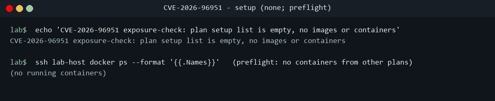
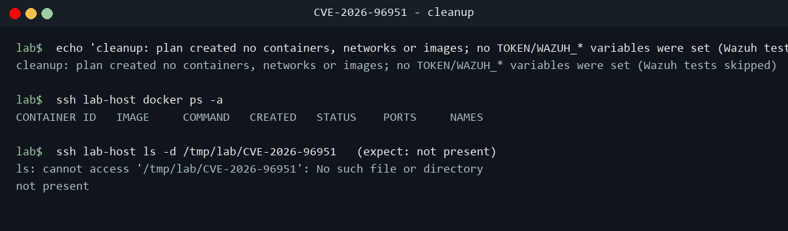
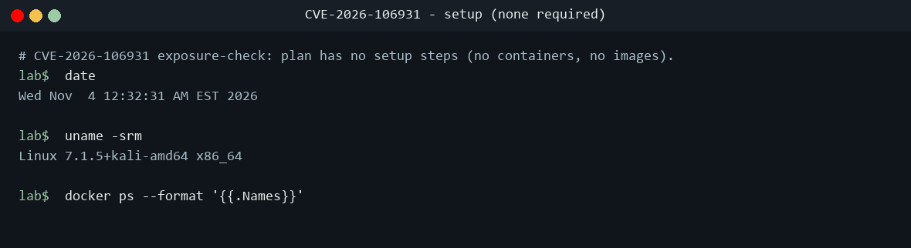

# Thirty Days of Exposure Checks: Version and Configuration Evidence from the Lab

*A TeamStarWolf case study. Published 4 November 2026; every source checked on that date except two opened on 3 November (sources 17 and 18).*

[All case studies](/case-studies/README.md) · Related: [CVE Reference](/CVE_REFERENCE.md), [CWE Reference](/CWE_REFERENCE.md), [Notable Incidents](/NOTABLE_INCIDENTS.md), [Vulnerability Prioritization](/VULNERABILITY_PRIORITIZATION_REFERENCE.md), [Vulnerability Management](/VULNERABILITY_MANAGEMENT_REFERENCE.md), [Container Security](/CONTAINER_SECURITY_REFERENCE.md), [Triage a CVE](/guides/TRIAGE_A_CVE.md), [PHP2Shell, October 2026](/case-studies/PHP2SHELL_OCTOBER_2026.md), [Log4Shell](/case-studies/LOG4SHELL.md), [Linux TCP use-after-free](/case-studies/LINUX_TCP_UAF_2026.md), [Ghostcat](/case-studies/GHOSTCAT_CVE_2020_1938.md), [ProFTPD mod_copy](/case-studies/PROFTPD_MOD_COPY_CVE_2015_3306.md), [Magento PolyShell](/case-studies/MAGENTO_CVE_2026_48356.md), [Node.js Brotli](/case-studies/NODEJS_CVE_2026_111497.md), [PHP 8.4.27](/case-studies/PHP_8_4_27_CVES.md), [Collabora CODE in Nextcloud](/case-studies/NEXTCLOUD_RICHDOCUMENTS_CVE_2026_110447.md), [Plex2Shell](/case-studies/PLEX_MEDIA_SERVER_2026_CVES.md)

<!-- meta:start (written by scripts/build_doc_meta.py from data/doc_meta.yaml; do not edit) -->

<table class="tsw-meta-card">
<tr><th scope="row" align="left" valign="top">Who this is for</th><td>

Vulnerability management leads, patch-queue and exposure owners, scanner engineers and security engineers who check KEV entries against their own hosts

</td></tr>
<tr><th scope="row" align="left" valign="top">Level</th><td>

Intermediate

</td></tr>
<tr><th scope="row" align="left" valign="top">Reading time</th><td>

About 45 min (10,325 words at 230 words a minute)

</td></tr>
<tr><th scope="row" align="left" valign="top">Read this when</th><td>

You own a patch queue and need to decide whether a KEV entry applies to your hosts, you want a version-plus-precondition method for exposure checks, or you need the facts of the KEV additions of 4 October to 3 November 2026

</td></tr>
<tr><th scope="row" align="left" valign="top">Start at</th><td>

[Executive summary](#executive-summary), [Part 2: six exposure checks in depth](#part-2-six-exposure-checks-in-depth), [Part 5: the method, from the KEV feed to a per-host verdict](#part-5-the-method-from-the-kev-feed-to-a-per-host-verdict)

</td></tr>
</table>

<details class="tsw-meta-more"><summary>More about this page (pairs with, last reviewed)</summary>

<table class="tsw-meta-card">
<tr><th scope="row" align="left" valign="top">Pairs with</th><td>

[CVE Reference](/CVE_REFERENCE.md), [Vulnerability Management Reference](/VULNERABILITY_MANAGEMENT_REFERENCE.md), [Vulnerability Prioritization Reference](/VULNERABILITY_PRIORITIZATION_REFERENCE.md), [Triage a CVE](/guides/TRIAGE_A_CVE.md), [PHP2Shell and the October 2026 Attack Wave](/case-studies/PHP2SHELL_OCTOBER_2026.md)

</td></tr>
<tr><th scope="row" align="left" valign="top">Last reviewed</th><td>

No review recorded yet

</td></tr>
</table>

</details>

<!-- meta:end -->

## Executive summary

If you own a patch queue, the question every known-exploited listing puts to you is simple: are we running it, and is it the bad build? This study answers that question for a month of real listings, on real software, with the terminal output to show for it. Between 4 October and 3 November 2026 CISA added 34 vulnerabilities to its Known Exploited Vulnerabilities (KEV) catalog [4]. A lab run on 3 and 4 November 2026 built a check for each of the 24 entries that had a container image or could be checked on a local host, plus a 25th plan for Ghostcat (CVE-2020-1938), which the owner asked for and which is not in the window, and, wherever an image existed, ran it against a matched pair of targets on loopback: one build below the vendor's fix and one at or above it [4] [43].

This is the companion that covers the method and the checks that do not have a study of their own. It walks through six exposure checks in depth (WordPress core, the Linux kernel flaw called Fragnesia, SiteGuard Server Edition, the AhsayCBS pair, a Windows Shell Mark-of-the-Web bypass, and ONLYOFFICE Document Server), the six plans that were blocked, inconclusive or skipped, and what the whole run teaches about version evidence. The short version: a version string is where an exposure check starts, not where it ends. Several fixed and vulnerable builds print the same banner. Several flaws are reachable only when one configuration line is set. Public records disagree: NVD and the GitHub advisory give different affected ranges for Strapi, and the vendor, NVD and CISA weigh the WordPress flaw differently [30] [31] [1] [3] [4]. And a workaround changes the configuration while leaving the version a scanner reads untouched (**Demonstrated**) [43].

Evidence grade: the vulnerabilities, fixed versions and KEV listings in Parts 1 to 3 are **Confirmed** from the vendor, NVD and CISA records; the fixed builds named in Part 4 are the lab plans' thresholds, sourced in each home study; the in-the-wild exploitation write-ups for AhsayCBS are **Reported**; every lab observation is **Demonstrated** with its capture file named; the playbook lessons drawn from them are **Inferred**.

### Key facts at a glance

| Field | Value |
|---|---|
| Window | KEV additions dated 2026-10-04 to 2026-11-03: 34 entries in catalog version 2026.11.03 (1,767 entries in all) [4] |
| Lab coverage | 24 of the 34 entries had a container image or a local check (plus a Ghostcat plan outside the window); appliance entries (Ivanti Connect Secure, Cisco ASA/FTD and Secure Email Gateway, Fortinet, PAN-OS, BeyondTrust, Arista VeloCloud, VMware ESX) had no lab target [4] [43] |
| Covered in depth here | CVE-2026-119977 (WordPress), CVE-2026-46300 (Linux kernel, Fragnesia), CVE-2026-106931 (SiteGuard), CVE-2026-105133 and CVE-2026-105134 (AhsayCBS), CVE-2026-96951 (Windows Shell), CVE-2021-3199 (ONLYOFFICE) |
| Blocked, inconclusive or skipped | Blocked: CVE-2015-5477 (BIND), CVE-2023-22894 (Strapi), CVE-2026-88779 (NetScaler). Inconclusive: CVE-2016-3081 (Struts), CVE-2026-21589 (Confluence). Skipped: CVE-2026-110936 (Siemens Software Center) [43] |
| Summarized with a home study | PHP CVE-2026-109618 and CVE-2026-109619, Node.js CVE-2026-111497, ProFTPD CVE-2015-3306, Nextcloud CVE-2026-110447, Ghostcat CVE-2020-1938, Plex CVE-2026-96652 and GitLab CVE-2026-97229 [43] |
| Exploit code run | No public exploit that changes a system was run. Most checks read a version, a package record, a configuration line or a log; two sent benign behavior probes: a mod_copy copy of /etc/hostname to a marker file on the ProFTPD pair and a public read-only detection script on the Confluence pair [43] |
| Oldest flaw newly listed | Five CVEs from 2015 to 2023 added on 2026-10-08, among them ONLYOFFICE CVE-2021-3199, more than five years after NVD published it [4] [23] |
| Latest listing | WordPress CVE-2026-119977: added 2026-11-03, due 2026-11-06, the only due date in this study still open on 4 November [4] |
| Most common trap | A banner or bundled-library string that reads the same on fixed and vulnerable builds: ProFTPD, Node.js Brotli and GitLab's Ruby (**Demonstrated**) [43] |
| Cleanup | Every plan's containers and images removed; 14 dangling anonymous volumes and some empty directories were left on the lab host, not re-checked on 4 November [44] |

### Key findings

- **A version match is not exposure when a precondition applies.** ONLYOFFICE CVE-2021-3199 needs JWT turned on, Struts CVE-2016-3081 needs Dynamic Method Invocation, NetScaler CVE-2026-88779 is exploitable only with SAML configured (the lab plan's reading), and Ghostcat needs an active AJP connector. For the first three the lab saw a version in the affected range (for NetScaler, from the image tag only), and for Ghostcat the connector line itself differed between builds. The precondition settled ONLYOFFICE and Ghostcat; for Struts and NetScaler it was not observed, which is why those plans stayed inconclusive or blocked (**Demonstrated**; the reading is **Inferred**) [43] [23] [28].
- **Banners lie in both directions.** ProFTPD's vulnerable and patched builds both print `1.3.6rc1 (git)`; Node.js 24.22.0 and 24.22.1 both report Brotli `1.2.0`; GitLab 19.4.1 and 19.4.2 bundle the same Ruby string. Only the package manifest, the product version or the product's behavior told them apart (**Demonstrated**) [43].
- **The public record can disagree with itself.** NVD's Strapi CVE-2023-22894 text still reads "through 4.5.5", while the GitHub advisory runs to 4.8.0 [31] [30]. WordPress rates CVE-2026-119977 low on its own advisory, NVD carries an 8.1 High from Wordfence, and CISA lists it as exploited with a three-day clock [1] [3] [4]. A check built on one record alone gets a different answer (**Inferred**).
- **Workarounds do not move the version.** After the PHP2Shell interim limits were applied, the PHP container still sent `X-Powered-By: PHP/8.4.26`, and the WordPress deny rule changed an HTTP status, not `$wp_version` (**Demonstrated**) [43]. A scanner keyed on version keeps flagging a mitigated host, so the workaround needs its own record (**Inferred**).
- **Parsing bugs are exposure bugs.** A Plex version grep also matched the XML prolog and called a fixed server "NOT patched"; an ONLYOFFICE regex matched nothing on minified JavaScript; `pgrep -f -i siteguard` matched the shell running the check (**Demonstrated**) [43].
- **Lab blockers are facts worth publishing.** A public vulnerable BIND image could not be pulled at all because Docker 28 removed the schema 1 manifest format; a Strapi image needed package downloads on first boot; NetScaler CPX needed a licence acceptance and Confluence a licence key to finish setup, both the owner's to give, not a lab script's (**Demonstrated**; **Confirmed** from Docker and NetScaler documentation) [43] [27] [33].

### Top recommendations

1. Treat every KEV entry as two checks, not one: the version against the vendor's fixed build, then the configuration line that makes the flaw reachable. Write both down per product before you scan [43] (**Inferred**).
2. Read versions from the package manager or the product's own manifest (`dpkg-query`, `rpm -q`, `version.txt`, `version-manifest.txt`, `wp-includes/version.php`), and use banners only to find hosts, never to clear them [43].
3. Compare versions with a version-aware tool (`sort -V`, `dpkg --compare-versions`, PowerShell `[version]`), and compare against the threshold for your distribution, not another distribution's line [43].
4. Record workarounds separately from patches, with the configuration evidence that proves them, so the version-keyed finding can be closed or suppressed on purpose (**Inferred**).
5. Where a vendor says patching may erase attack traces, collect them first: SiteGuard tells customers to download diagnostic information before updating [11]. CISA marks forensic triage Yes for six of the seven entries whose field this study records (AhsayCBS CVE-2026-105133 is No) [4].
6. When a lab or a scanner cannot run a check, say so in the record and say why. A "blocked" with a reason is more useful than a silent gap [43] (**Inferred**).

## Scope and method

This study covers the KEV additions dated 4 October to 3 November 2026 and the lab run of 3 and 4 November 2026. It concentrates on the plans that ran a check and have no study of their own, and summarizes in one paragraph each the checks whose home is another study. Every source in the Sources table was opened on 4 November 2026, except the Horizon3 and Huntress analyses of AhsayCBS, which were opened on 3 November 2026 and not re-opened; their claims stay **Reported**.

| Grade | Meaning |
|---|---|
| Confirmed | A primary source was opened: the vendor advisory or release note, NVD, the CISA KEV feed, a distribution tracker, or the live MITRE page |
| Reported | A secondary source's account, not independently corroborated (research write-ups, a threat-hunting report) |
| Demonstrated | Shown in the lab run; the capture file is named |
| Inferred | This study's reasoning from the record and the lab, labelled where it appears |

How the lab worked (**Demonstrated**, plan.json and the capture files for each CVE) [43]: each plan listed setup, test, exposure-check, mitigation and cleanup steps. Containers ran from public images, bound to `127.0.0.1` or placed on an internal Docker network, in pairs that differed by the vendor's fix. Host-level flaws (the Linux kernel, SiteGuard, Windows) were checked read-only on the host itself. A plan whose only public proof of concept could change a system (create an account, plant a web shell, rewrite a binary in memory) recorded that code and ran a version check instead. The screenshots are renderings of the captured terminal output with a neutral `lab$` prompt and the lab host anonymized. Exploit-class steps are described in one sentence and never shown or quoted.

## Part 1: the thirty-day list

### What CISA added

The KEV feed (catalog version 2026.11.03) lists 34 additions in the window [4]. The ones this study touches, in order of listing:

| KEV added | Due | CVE | Product | CWE (KEV) | Ransomware use | Forensic triage | Lab outcome |
|---|---|---|---|---|---|---|---|
| 2026-10-04 | 2026-10-07 | CVE-2026-88779 | Citrix NetScaler | CWE-119 | | | Blocked |
| 2026-10-08 | 2026-10-11 | CVE-2015-3306 | ProFTPD | CWE-284 | | | Checked; home study |
| 2026-10-08 | 2026-10-11 | CVE-2015-5477 | ISC BIND | CWE-19 | | | Blocked |
| 2026-10-08 | 2026-10-11 | CVE-2016-3081 | Apache Struts | CWE-77 | | | Inconclusive |
| 2026-10-08 | 2026-10-11 | CVE-2021-3199 | ONLYOFFICE Docs | CWE-22 | Unknown | Yes | Checked (Part 2) |
| 2026-10-08 | 2026-10-11 | CVE-2023-22894 | Strapi | CWE-312 | | | Blocked |
| 2026-10-13 | 2026-10-16 | CVE-2026-96951 | Windows Shell | CWE-77 | Unknown | Yes | Checked (Part 2) |
| 2026-10-14 | 2026-10-17 | CVE-2026-105133 | AhsayCBS | CWE-287 | Unknown | No | Checked (Part 2) |
| 2026-10-14 | 2026-10-17 | CVE-2026-105134 | AhsayCBS | CWE-77, CWE-78 | Unknown | Yes | Checked (Part 2) |
| 2026-10-15 | 2026-10-18 | CVE-2026-21589 | Atlassian | CWE-552 | | | Inconclusive |
| 2026-10-20 | 2026-10-23 | CVE-2026-106931 | SiteGuard Server Edition | CWE-78 | Unknown | Yes | Checked (Part 2) |
| 2026-10-28 | 2026-10-31 | CVE-2026-46300 | Linux kernel | CWE-456 | Unknown | Yes | Checked (Part 2) |
| 2026-11-03 | 2026-11-06 | CVE-2026-119977 | WordPress | CWE-367 | Unknown | Yes | Checked (Part 2) |

(**Confirmed**: KEV feed [4]; NVD and JVN list the same CWEs [14] [10] [3].) (Blank cells are fields this study did not record.) Five of the additions are old: on 2026-10-08 CISA listed CVE-2015-3306, CVE-2015-5477, CVE-2016-3081, CVE-2021-3199 and CVE-2023-22894 together, all with the same three-day due date [4]. Every due date in the table except WordPress's had passed by the date of this study.

### What the lab could and could not reach

The appliance entries in the window had no lab target: three Ivanti Connect Secure entries, Cisco ASA/FTD, Cisco Secure Email Gateway, Fortinet, PAN-OS, BeyondTrust, Arista VeloCloud and VMware ESX [4]. That is a real limit of a container lab, and it is the part of the list most likely to sit on an organization's edge. The lab ran plans for the 24 entries that had a container image or a local check, plus one for Ghostcat [4] [43]. Of those, this study's checks fell into four groups:

| Outcome | Plans |
|---|---|
| A version verdict on a matched pair or a real host | WordPress, AhsayCBS (two CVEs), ONLYOFFICE (with the JWT precondition), Windows Shell |
| Read-only host inventory, no version verdict from the plan | Fragnesia (host state recorded; the plan's threshold line did not apply), SiteGuard (product absent) |
| Blocked: no runnable vulnerable target | BIND, Strapi, NetScaler |
| Inconclusive: the check ran but could not settle the precondition | Struts, Confluence |
| Skipped: the check needs a host the lab did not have | Siemens Software Center |

(**Demonstrated**, capture files per CVE) [43]

### Timeline of the six in-depth flaws

| Date | Event | Source |
|---|---|---|
| 2021-01-26 | NVD publishes ONLYOFFICE CVE-2021-3199 | [23] |
| 2026-05-13 | Fragnesia disclosed on oss-security | [7] |
| 2026-05-23 | NVD publishes CVE-2026-46300 | [6] |
| 2026-09-29 | SiteGuard notifies customers with support contracts | [11] |
| 2026-10-04 | NVD publishes the AhsayCBS pair | [14] [16] |
| 2026-10-07 | Huntress observes AhsayCBS exploitation from 23:20 UTC (**Reported**) | [18] |
| 2026-10-08 | CISA lists CVE-2021-3199 | [4] |
| 2026-10-12 | Ahsay says its earlier patches were incomplete | [15] |
| 2026-10-13 | Microsoft releases CVE-2026-96951, exploited; CISA lists it the same day | [20] [4] |
| 2026-10-14 | CISA lists the AhsayCBS pair; Horizon3 publishes its proof of concept repository; SiteGuard and JVN publish CVE-2026-106931 | [4] [19] [11] [10] |
| 2026-10-20 | CISA lists CVE-2026-106931 | [4] |
| 2026-10-26 | Microsoft revision 2 adds Edge to CVE-2026-96951 | [20] |
| 2026-10-28 | WordPress 7.1.4 security release; CISA lists Fragnesia | [2] [4] |
| 2026-10-29 | WordPress publishes its advisory GHSA-4w3m-c66w-69mg | [1] |
| 2026-10-31 | NVD publishes CVE-2026-119977 | [3] |
| 2026-11-03 | CISA lists CVE-2026-119977, due 2026-11-06 | [4] |
| 2026-11-03 to 2026-11-04 | Lab run | [43] |

## Part 2: six exposure checks in depth

Each section gives the flaw, the public record, why the lab ran a check instead of a test, what the lab showed, and how to find and fix it on real hosts. They run in the order CISA listed them.

### 2.1 ONLYOFFICE Document Server, CVE-2021-3199

**The flaw.** A directory traversal with remote code execution in the `/upload` endpoint of ONLYOFFICE Document Server before 5.6.3, reached through a `/..` sequence in an image upload parameter, and only when JWT is in use (**Confirmed**: NVD) [23]. NVD scores it CVSS 3.1 9.8 Critical with CWE-22 and a CPE of `document_server` below 5.6.3 [23]. The 5.6.3 changelog lists the fix as a path traversal via image upload parameters, Bug #46113 (**Confirmed**) [24].

**The record.** CISA listed it on 2026-10-08, more than five years after NVD published it, with a due date of 2026-10-11, ransomware use Unknown and forensic triage Yes (**Confirmed**) [4]. CISA's SSVC entry in the NVD record (ADP) reads exploitation active, automatable yes, technical impact total (**Confirmed**) [23]. GitHub advisory GHSA-vm8r-r39c-96c6 rates it critical (**Confirmed**) [45].

**Why a check.** The only public proof of concept, moehw/poc_exploits (created 2021-01-21 and listed as an NVD reference), is classed destructive-or-weaponized in the lab plan, so the lab compared a 5.6.2 container with a 5.6.3 container by `api.js` version, health check, package version and JWT setting, and sent no `/upload` request (**Confirmed**: plan.json) [43].

**What the lab showed.** Both images were pulled by tag, their digests recorded, and run with JWT enabled, on `127.0.0.1:8562` (5.6.2) and `127.0.0.1:8563` (5.6.3), and both health checks returned `true` (**Demonstrated**, 01-setup.txt) [43].


The plan's first `api.js` regex matched nothing on the minified file; the fallback grep for a quoted version string worked (**Demonstrated**, 02-test.txt) [43]. The package database agreed with it, and the JWT setting was on in both:

```text
lab$ for c in oo-cve-2021-3199-vuln oo-cve-2021-3199-fixed; do ... dpkg --compare-versions "$v" lt 5.6.3 ...; done
oo-cve-2021-3199-vuln 5.6.2-2 VULNERABLE to CVE-2021-3199 (if JWT enabled)
oo-cve-2021-3199-fixed 5.6.3-2 FIXED for CVE-2021-3199
```

(**Demonstrated**, 02-test.txt; the loop body is shortened here.)


The mitigation check confirmed the fixed container runs 5.6.3-2, that the JWT secrets on both are set and not the default, and that both listen on loopback only (**Demonstrated**, 04-mitigation.txt) [43].


Cleanup removed both containers, their 14 volumes and both images, and the ports were clear (**Demonstrated**, 05-cleanup.txt) [43].


**Find and fix it.** On Debian-family installs, `dpkg-query -W -f='${Package} ${Version}\n' onlyoffice-documentserver` and compare with 5.6.3; on RPM installs, `rpm -q onlyoffice-documentserver`; from the network, the quoted version string in `/web-apps/apps/api/documents/api.js` (**Demonstrated** method) [43]. Then read the `token.enable` block in `/etc/onlyoffice/documentserver/local.json`. The NVD text makes JWT a condition of the flaw [23], so an old server with JWT on is the exposed case; that turning on a hardening feature is what opens the path is this study's reading (**Inferred**). Upgrade to 5.6.3 or later [24] [23].

### 2.2 Windows Shell, CVE-2026-96951

**The flaw.** A Windows Shell security feature bypass, CWE-77, released on 2026-10-13. A successful exploit evades Mark of the Web: the attacker sends a crafted file by email or instant message, and the user has to click a link or open the file (**Confirmed**: Microsoft) [20]. Microsoft rates it Important with CVSS 8.8 base and 8.2 temporal (`E:F/RL:O/RC:C`), marks it exploited and not publicly disclosed, and added Edge in revision 2 on 2026-10-26 [20].

**The record.** NVD (Analyzed) sets fixed-build thresholds per Windows release; any build below its line is vulnerable (**Confirmed**) [21]:

| Release | Fixed build (NVD threshold) |
|---|---|
| Windows 10 1607 and Server 2016 | 10.0.14393.9612 |
| Windows 10 1809 and Server 2019 | 10.0.17763.9376 |
| Windows 10 22H2 | 10.0.19045.7807 |
| Windows 11 23H2 | 10.0.22631.7652 |
| Windows 11 24H2 | 10.0.26100.9711 |
| Windows 11 25H2 | 10.0.26200.9711 |
| Windows 11 26H2 | 10.0.26300.9711 |
| Server 2022 | 10.0.20348.5761 |

CISA listed it on 2026-10-13, due 2026-10-16, ransomware use Unknown, forensic triage Yes (**Confirmed**) [4]. CISA's SSVC entry in the NVD record (ADP) reads active, not automatable, total (**Confirmed**) [21]. A GitHub repository search for the CVE returned no results on 2026-11-04 [22]. Microsoft's `E:F` temporal metric says it judges functional exploit code to exist, which is not the same as public code (**Inferred**) [20] [22].

**Why a check.** No proof of concept was found and the flaw is in an operating-system component with no container image, so the lab read the build number and installed updates on a Windows workstation and compared them with the fixed build (**Confirmed**: plan.json) [43].

**What the lab showed.** The plan created nothing to set up: no images, no containers, and no containers from other plans were running on the lab host (**Demonstrated**, 01-setup.txt) [43].



The workstation (hostname redacted to `ASSESSED-PC`) reported build 26300 with an update build revision of `0x265a`, which is 9818, so build 26300.9818. Security Update KB5127647 was installed on 10/16/2026, and Edge was 156.0.4314.58 (**Demonstrated**, 03-exposure.txt) [43].


Both version comparisons came back `True`: the build against 10.0.26300.9711 and Edge against the plan's Edge threshold of 154.0.4258.62 (**Demonstrated**, 04-mitigation.txt) [43].

![Terminal output on a Windows workstation: a PowerShell [version] comparison of 10.0 plus CurrentBuild and UBR against 10.0.26300.9711 prints True, and a [version] comparison of the Edge product version against 154.0.4258.62 prints True](/case-studies/assets/exposure-checks-2026-11/CVE-2026-96951/04-mitigation.png)



(**Demonstrated**, 05-cleanup.txt) [43]

**Find and fix it.** Read `CurrentBuild` and `UBR` from `HKLM\SOFTWARE\Microsoft\Windows NT\CurrentVersion`, build `[version]('10.0.{0}.{1}' -f $cv.CurrentBuild, $cv.UBR)` in PowerShell, and compare it with the threshold for that release in the table above; `Get-HotFix` shows the update that moved it (**Demonstrated** method) [43] [21]. Compare as a version, not as text: a text comparison misorders revision numbers of different lengths (**Inferred**). Check Edge too, since Microsoft added it in revision 2 [20].

### 2.3 AhsayCBS, CVE-2026-105133 and CVE-2026-105134

**The flaws.** CVE-2026-105133 is improper authentication in `checkSysPwd` (`com/ahsay/obs/api/ApiStructsAction.java`) of the AhsayCBS backup server API, reachable remotely through the `random` argument. It affects up to 9.15.2.69 and 10.3.4.44 and is fixed in 9.15.2.70 and 10.3.4.45; NVD notes the initial patch did not fix it properly (**Confirmed**) [14]. The CNA, VulDB, scores it CVSS 3.1 7.3 High and CVSS 4.0 6.9 Medium, CWE-287 [14]. CVE-2026-105134 is described by NVD and KEV as OS command injection in the Replication Receiver at `/rps/api/json/UpdateReceivers.do` through the `random` argument, remote and unauthenticated, with the same affected and fixed versions, CVSS 3.1 10.0 Critical (scope changed) and CVSS 4.0 10.0, CWE-77 and CWE-78 (**Confirmed**) [16].

**A disagreement on mechanism.** Horizon3 describes the exploitable CVE-2026-105134 step as a path traversal in the replication upload that writes a JSP file, with `UpdateReceivers.do` only configuring the receiver, which differs from the NVD and KEV wording (**Reported**; opened 2026-11-03, not re-opened) [17]. The fixed version is the same either way.

**The record.** Ahsay's notice of October 12, 2026 says the earlier patches, v9.15.2.59 and v10.3.4.0, did not fully address either CVE, and tells customers to apply hotfix v10.3.4.45 (v10) or v9.15.2.70 (v7, v8 and v9) from the partner portal and then reboot (**Confirmed**) [15]. CISA listed both on 2026-10-14, due 2026-10-17, ransomware use Unknown, as a chain. The two entries differ: CVE-2026-105133 has forensic triage No and CVE-2026-105134 has forensic triage Yes (**Confirmed**) [4]. CISA's SSVC entry in the NVD record (ADP) reads active, automatable yes, partial for CVE-2026-105133 and active, automatable yes, total for CVE-2026-105134 (**Confirmed**) [14] [16]. Huntress observed exploitation of the chain from 2026-10-07 23:20 UTC, five organisations by 2026-10-08, with JSP web shells and XMRig miners (**Reported**; opened 2026-11-03, not re-opened) [18].

**Why a check.** A public proof of concept, horizon3ai/AhsayCBS-Auth-Bypass-RCE (created 2026-10-14, no licence), exists [19]. The lab plan classes it destructive-or-weaponized because it creates an admin account or plants a web shell, so it was recorded only, and the lab compared the tags, digests and installed versions of throwaway `10340` and `103445` containers (**Confirmed**: GitHub API and plan.json) [19] [43].

**What the lab showed.** The vulnerable image was pulled by tag, its digest recorded, and the container started on an internal Docker network behind a loopback-only proxy (**Demonstrated**, CVE-2026-105133 01-setup.txt) [43].

![Terminal output on the lab host: docker pull of ahsay/cbs10:10340 with digest sha256:295396bc ending 2e7a; docker image inspect showing the repo digest, exposed ports 443 and 80, and an image version label of 24.04; docker network create --internal cbs-lab-net; docker run of cbs-lab-vuln on that network; a pull of alpine/socat 1.8.0.0 and a socat proxy published on 127.0.0.1:8080 to the container's port 80; a pull of ahsay/cbs10:103445 with digest sha256:1fd7007b ending fb01; and docker ps listing cbs-lab-proxy and cbs-lab-vuln up](/case-studies/assets/exposure-checks-2026-11/CVE-2026-105133/01-setup.png)

The install metadata settled it. `/usr/local/cbs/version.txt` read `10.3.4.0` in the `ahsay/cbs10:10340` container and `10.3.4.45` in the `103445` container, and `docker images --digests` tied each tag to its digest (**Demonstrated**, CVE-2026-105134 03-exposure.txt) [43]. The lab host itself had no `/usr/local/cbs`. The Windows checks in the plan (the `cbssvc` service, the uninstall registry and a listing of `.jsp` files under the web apps folder) do not apply on a Linux Docker host and were not run.

![Terminal output on the lab host: a find for version files inside cbs-vuln prints /usr/local/cbs/version.txt with 10.3.4.0 and inside cbs-fixed prints the same path with 10.3.4.45; the same find on the Docker host exits 1; docker images --digests --no-trunc lists ahsay/cbs10 103445 with digest sha256:1fd7007b and 10340 with digest sha256:295396bc; docker ps lists cbs-fixed, cbs-vuln and cbs-vuln-web; and comments note the Windows checks were not applicable and state the decision rule, v7 to v9 affected below 9.15.2.70 and v10 below 10.3.4.45](/case-studies/assets/exposure-checks-2026-11/CVE-2026-105134/03-exposure.png)

```text
lab$ for c in cbs-vuln cbs-fixed; do ... sort -V ...; done
cbs-vuln 10.3.4.0 AFFECTED
cbs-fixed 10.3.4.45 FIXED
```

(**Demonstrated**, CVE-2026-105134 04-mitigation.txt; the loop body is shortened here.) No request was sent to any `/rps/` or `.do` endpoint, and the proxy block, the post-patch hunt and the reboot were not exercised (04-mitigation.txt).


The 10.3.4.0 reading matters: it is one of the two builds Ahsay itself calls an incomplete patch [15]. A host that applied the first fix and stopped looks patched to anyone who checks only "did we apply the October hotfix" (**Inferred**). Cleanup removed all three containers, the plan's own internal network and both images, after checking that no other container still used them (**Demonstrated**, CVE-2026-105134 05-cleanup.txt) [43].

![Terminal output on the lab host: docker rm -f removes cbs-vuln, cbs-fixed and cbs-vuln-web; docker network rm removes cbs-105134-net; a check prints no container uses an ahsay image; docker rmi untags ahsay/cbs10:10340 and 103445; a comment explains that the plan's global prune was replaced by targeted checks; the dangling image check lists none; the final checks print clean, an empty docker ps -a and only the bridge, host and none networks; and the lab directory listing shows only another plan's folder](/case-studies/assets/exposure-checks-2026-11/CVE-2026-105134/05-cleanup.png)

**Find and fix it.** On Linux installs read `/usr/local/cbs/version.txt`; on Windows the plan's checks were the `cbssvc` service and the uninstall registry entry, which the lab did not run [43]. Treat 10.3.4.0 and 9.15.2.59 as vulnerable, and upgrade to 10.3.4.45 (v10) or 9.15.2.70 (v7 to v9), then reboot [15]. Given Huntress's account of JSP web shells and miners [18], look for `.jsp` files that do not belong to the product and for unexpected miner processes before you close the ticket (**Inferred** from a **Reported** source).

### 2.4 SiteGuard Server Edition, CVE-2026-106931

**The flaw.** OS command injection, CWE-78, in the statistics feature of SiteGuard Server Edition, a host-based web application firewall. An attacker may run arbitrary OS commands as root or SYSTEM (**Confirmed**: JVN) [10].

**The record.** Affected are Ver2.20 and later with the statistics feature enabled, which is on by default: the Apache, Nginx and IIS editions before Ver8.00 Update5, and the FreeBSD Apache and Nginx editions before Ver7.00 Update6. IIS Ver3.10 to Ver4.00 Update4 are not affected. The vendor offers a file-replacement patch, including for end-of-life versions (**Confirmed**: vendor) [11]. The vendor tells customers to download the diagnostic information before updating, because the update or patch may erase attack traces, and says customers with support contracts were notified on 2026-09-29 [11]. JPCERT/CC scores it CVSS 4.0 8.5 and CVSS 3.0 7.8 with `AV:L/PR:L`; the vendor and JVN both state exploitation in the wild is confirmed; NVD published it on 2026-10-14 and lists it as Analyzed (**Confirmed**) [12] [10] [11]. CISA listed it on 2026-10-20, due 2026-10-23, ransomware use Unknown, forensic triage Yes (**Confirmed**) [4]. CISA's SSVC entry in the NVD record (ADP) reads active, not automatable, total (**Confirmed**) [12]. A GitHub repository search for the CVE returned no results [13].

**Why a check.** No proof of concept was found and the product is commercial and licensed with no official image, so the lab ran a read-only package, configuration and process inventory on a host without SiteGuard. The result is a negative one (**Confirmed**: plan.json) [43].

**What the lab showed.** There was nothing to set up (**Demonstrated**, 01-setup.txt) [43].



Every check came back empty: `dpkg`, `rpm`, `pkg`, the configuration grep across the Apache and Nginx folders, and the process listing, ending in `siteguard package matches: 0` (**Demonstrated**, 03-exposure.txt) [43].


One step gave a false positive worth knowing about. `pgrep -f -i siteguard` matched the capture wrapper's own shell, because the wrapper's command line contained the word, and the only child of that "parent" was the `ps` command doing the checking (**Demonstrated**, 02-test.txt) [43]. A process-name check that searches full command lines will find itself; filter on the executable name, or use the bracket trick (`grep -i [s]iteguard`) the plan used for `ps` (**Inferred**).


(**Demonstrated**, 04-mitigation.txt and 05-cleanup.txt) [43]

**Find and fix it.** On Linux, `dpkg -l | grep -i siteguard` and `rpm -qa | grep -i siteguard`; on FreeBSD, `pkg info | grep -i siteguard`; then grep the web server configuration for SiteGuard modules (**Demonstrated** method on Linux) [43]. The admin console's version and the statistics-feature setting were not checked, because no SiteGuard console existed on the lab host (02-test.txt). On a host that has it: download the diagnostic information first, then update to Ver8.00 Update5 (Apache, Nginx, IIS) or Ver7.00 Update6 (FreeBSD), or apply the vendor's file-replacement patch [11].

### 2.5 Linux kernel, CVE-2026-46300 (Fragnesia)

**The flaw.** `skb_try_coalesce()` loses the `SKBFL_SHARED_FRAG` marker when it moves paged fragments, so ESP input can decrypt in place over fragments backed by the page cache; the fix propagates the marker (**Confirmed**: NVD) [6]. It was disclosed on oss-security on 2026-05-13 as a Dirty Frag class local privilege escalation in XFRM ESP-in-TCP, discovered by William Bowling with the V12 team; no race is required, and the mitigation is the same as for Dirty Frag (**Confirmed**) [7]. Red Hat says a low-privileged local attacker can write into the page cache of read-only files and overwrite privileged binaries to gain root, rates it Important because access is local, and gives the mitigation in bulletin RHSB-2026-003 [8].

**The record.** NVD scores it CVSS 3.1 7.8 High (`AV:L/AC:L/PR:L/UI:N`) and lists CWE-787 (NVD), CWE-456 (CISA ADP) and CWE-123 [6]. Upstream affected ranges are 3.9 through 5.10.257, 5.11 to before 5.15.208, 5.16 to before 6.1.174, 6.2 to before 6.6.141, 6.7 to before 6.12.91, 6.13 to before 6.18.33, 6.19 to before 7.0.10 and the 7.1 release candidates, plus Siemens SIMATIC S7-1500 CPU 1518-4 PN/DP MFP firmware 3.1.5 to 3.1.6 (**Confirmed**) [6]. Ubuntu rates it high and lists fixed kernels of 5.15.0-181.191 (22.04), 6.8.0-124.124 (24.04), 6.17.0-35.35 (25.10) and 7.0.0-22.22 (26.04); 14.04, 16.04, 18.04 and 20.04 are not affected [9]. CISA listed it on 2026-10-28, due 2026-10-31, ransomware use Unknown, forensic triage Yes, CWE-456, and states it can be chained with CVE-2026-109618 and CVE-2026-109619 to implant PHP web shells and run commands as root (**Confirmed**) [4]. CISA's SSVC entry in the NVD record (ADP) reads active, not automatable, total (**Confirmed**) [6]. The PHP half of that chain is the subject of [the PHP2Shell study](/case-studies/PHP2SHELL_OCTOBER_2026.md) and of the [PHP 8.4.27 lab study](/case-studies/PHP_8_4_27_CVES.md).

**Why a check.** The plan classes it version-check. A kernel flaw is shared by every container on the host, and every public trigger rewrites the host's page cache of a real setuid binary, so the lab compared kernel package versions and module and user-namespace state only (**Inferred**: the plan's reasoning) [43].

**What the lab showed.** No container applies; the check ran read-only on the lab host (**Demonstrated**, 01-setup.txt) [43].


The running kernel was `7.1.5+kali-amd64` from package `7.1.5-1kali1`, and a second image, `linux-image-6.19.14+kali-amd64` at `6.19.14-1+kali1`, was also installed. `xfrm_user` was loaded; `esp4`, `esp6` and `rxrpc` were not loaded but were present and loadable, with no block in `/etc/modprobe.d/`; and `kernel.unprivileged_userns_clone` was `1` (**Demonstrated**, 02-test.txt, 03-exposure.txt and 04-mitigation.txt) [43].

![Terminal output on the lab host: uname -r prints 7.1.5+kali-amd64; dpkg-query prints linux-image-7.1.5+kali-amd64 7.1.5-1kali1; the plan's Ubuntu 24.04 threshold line prints FIXED, with a comment that it is not meaningful for a Kali kernel; rpm -q kernel reports the package is not installed; no reboot-required file; lsmod prints none loaded for esp4, esp6 and rxrpc; the modprobe.d grep prints no block configured; sysctl cannot stat the AppArmor user-namespace key and prints user.max_user_namespaces = 30834; a comment lists the upstream affected ranges; the base version prints 7.1.5; and /proc/version shows the Kali 7.1.5-1kali1 build of 2026-07-29](/case-studies/assets/exposure-checks-2026-11/CVE-2026-46300/03-exposure.png)

Two things in that output need care. First, the plan's grading line compared the Kali package version with Ubuntu 24.04's fixed build and printed `FIXED`, which means nothing for a Kali kernel; the version strings of two distributions do not order against each other (**Demonstrated**, 02-test.txt; the reading is **Inferred**). Second, read against NVD's upstream ranges, the running 7.1.5 is a 7.1 stable release, outside the listed ranges, while the fallback 6.19.14 image falls in "6.19 to before 7.0.10" (**Inferred** from [6]). A host that boots its fallback kernel after a failed update would boot into an affected one (**Inferred**).

The plan also took a forensic baseline. The SHA-256 of `/usr/bin/su` read through the page cache and read with `O_DIRECT` from disk matched, and the `O_DIRECT` MD5 matched the `util-linux` record in the dpkg database (**Demonstrated**, 02-test.txt) [43]. Because Fragnesia writes into the page cache and not the file on disk [8], a mismatch between the cached and direct reads of a setuid binary would be the sign to look for (**Inferred**).


(**Demonstrated**, 04-mitigation.txt and 05-cleanup.txt) [43]

**Find and fix it.** `uname -r` for the running kernel, then `dpkg-query -W -f='${Package} ${Version}\n' "linux-image-$(uname -r)"` (or `rpm -q kernel`), then compare with your own distribution's fixed build: for Ubuntu, the table above [9]; for Red Hat, RHSB-2026-003 [8]; for other distributions, their trackers. List every installed image, not only the running one (**Demonstrated** method) [43]. Until the fixed kernel is booted, check whether `esp4`, `esp6` and `rxrpc` are loaded or blockable, and whether unprivileged user namespaces are allowed, since the plan's interim checks looked for both (04-mitigation.txt); the vendor mitigation itself is in Red Hat's bulletin [8]. Hosts that also serve PHP are the ones KEV's chain names [4].

### 2.6 WordPress core, CVE-2026-119977

**The flaw.** During a full-package core update, WordPress extracted the new files into a predictable directory inside the web-served upgrade folder. An unauthenticated attacker who won the race against extraction could reach remote code execution (**Confirmed**: WordPress) [1].

**The record.** The vendor advisory, GHSA-4w3m-c66w-69mg, lists 25 branch ranges from 4.7.0 to 4.7.38 through 7.1.0 to 7.1.3, fixed in 7.1.4 with backports to every branch back to 4.7 (for example 7.0.8, 6.9.11 and 4.7.39), credits Umut Bayram, rates it low and carries no CVE id (**Confirmed**) [1]. WordPress 7.1.4 shipped as a security release on October 28, 2026, for a weakness in the upgrade process that can lead to code execution during the upgrade window [2]. NVD published CVE-2026-119977 on 2026-10-31 with CVSS 3.1 8.1 High (`AV:N/AC:H/PR:N/UI:N`, Wordfence as secondary) and CWE-367; when the record was read on 2026-11-04 its status was Undergoing Analysis and it had no CPE configuration (**Confirmed**) [3]. NVD's initial analysis added a WordPress CPE configuration (from 4.7 before 4.7.39 through each branch) on 2026-11-04 at 12:52 UTC, four days after publication, and the record read Analyzed when it was re-opened on 2026-11-11 (**Confirmed**) [3]. The CVE-bearing GitHub record GHSA-p6jj-qrp3-7m4g rates it high [46]. CISA listed it on 2026-11-03, due 2026-11-06, ransomware use Unknown, forensic triage Yes (**Confirmed**) [4]. CISA's SSVC entry in the NVD record (ADP) reads exploitation active, automatable no, technical impact total (**Confirmed**) [3]. No public exploit was found: the only repository a GitHub search returned was a self-described detection-only scanner created on 2026-11-04 (not read or run), and an empty CVE-named repository seen on 2026-11-03 now returns 404 [5].

Low from the vendor, high from NVD and GitHub, exploited according to CISA, and for its first four days no NVD CPE. For the first four days after publication, a CPE-keyed scanner would not have flagged WordPress for this CVE; the KEV listing on 2026-11-03 came before the CPE configuration on 2026-11-04 (**Inferred** from [3] [4]).

**Why a check.** No proof of concept was found, and the race exists only while a live core update runs. Showing it would mean requesting a staged installer, so the lab read `$wp_version` on 7.1.3 and 7.1.4 containers and tested denying web access to `wp-content/upgrade/` (**Confirmed**: plan.json) [43]. The setup pulled `wordpress:7.1.3` and `wordpress:7.1.4` by tag, recorded their digests, and ran them on `127.0.0.1:8080` and `127.0.0.1:8081` (**Demonstrated**, 01-setup.txt).


**What the lab showed.**

```text
lab$ docker exec wp-119977-vuln grep -E '^\$wp_version' /var/www/html/wp-includes/version.php
$wp_version = '7.1.3';
lab$ docker exec wp-119977-fixed grep -E '^\$wp_version' /var/www/html/wp-includes/version.php
$wp_version = '7.1.4';
```

(**Demonstrated**, 02-test.txt) Before any rule, `/wp-content/upgrade/` returned HTTP 302 on both containers, and the directory did not yet exist. After the lab created it on the vulnerable container with an `.htaccess` holding `Require all denied`, the same request returned 403, and Apache logged `AH01630: client denied by server configuration`. The fixed container, with no rule, stayed at 302 (**Demonstrated**, 02-test.txt and 04-mitigation.txt) [43]. The race itself was not exercised.


Two version sources were missing in the images: `wp-cli` was not installed, and with no database configured the page carried no generator meta tag (**Demonstrated**, 03-exposure.txt). On a live site the generator tag may be there, but it can also be removed by a plugin, so `version.php` is the record to read (**Inferred**).


(**Demonstrated**, 05-cleanup.txt) [43]

**Find and fix it.** Read `$wp_version` from `wp-includes/version.php` (or run `wp core version` where wp-cli is installed) and compare it with the fixed release for that branch: 7.1.4, 7.0.8, 6.9.11 and so on back to 4.7.39 [1]. Because the window opens only during a core update, the practical bridge is to keep the upgrade folder from being served over the web while updates run. The lab showed an Apache 2.4 `Require all denied` rule doing that on 7.1.3 (**Demonstrated**); it is not a vendor-documented workaround in the sources opened, and an Nginx equivalent was not tested (**Inferred**). Then update.

## Part 3: the plans that did not finish

Six plans in this study's set ended blocked, inconclusive or skipped. Each one says something about the environment, not only about the CVE.

### Blocked: ISC BIND, CVE-2015-5477

NVD says a remote attacker can crash `named` in BIND 9.x before 9.9.7-P2 and 9.10.x before 9.10.2-P3 with TKEY queries, through a REQUIRE assertion failure that makes the daemon exit, and lists CWE-19 and CWE-617 (**Confirmed**) [25]. ISC's AA-01272 lists 9.1.0 to 9.8.x, 9.9.0 to 9.9.7-P1 and 9.10.0 to 9.10.2-P2 as affected, 9.9.7-P2 and 9.10.2-P3 as fixed, and says there is no workaround: ACLs do not help, because the flaw is reached before ACL checks [26].

The vulnerable target never existed. Both the digest-pinned and the plain-tag pulls of `hmlio/vaas-cve-2015-5477` failed on Docker 28.5.2 with the schema 1 removal error, and the plan forbade rebuilding the image from its Dockerfile (**Demonstrated**, 01-setup.txt) [43]. Docker deprecated v2 schema 1 and Image v1 pulls in v19.03, disabled them by default in v26.0 and removed support in v28.2, and its error text matches the lab's (**Confirmed**) [27]. Many deliberately vulnerable images of this age were published in the old format; a lab on a current Docker will hit the same wall (**Inferred**).

Only the comparison container ran. It answered `version.bind` with `"9.18.50"` and `named -v` printed `BIND 9.18.50 (Extended Support Version)` (**Demonstrated**, 02-test.txt and 03-exposure.txt). No crash proof of concept was downloaded or run. That 9.18 is not affected is a reading of ISC's ranges, not a test (**Inferred**) [26].


**Find and fix it.** `named -v` on the host, or `dig version.bind chaos txt` from the network where the server has not hidden it, and compare with the fixed lines; patching is the only fix [26].

### Blocked: Strapi, CVE-2023-22894

GitHub advisory GHSA-jjqf-j4w7-92w8 says Strapi from 3.2.1 up to but not including 4.8.0 is affected, patched in 4.8.0 [30]. NVD's text still reads "Strapi through 4.5.5" (CWE-312, CVSS 3.1 4.9), which is narrower (**Confirmed**) [31]. A check built from the NVD text alone would miss 4.6.x and 4.7.x (**Inferred**). The lab plan used the GitHub range.

Both containers logged their Strapi version, `Using strapi 4.7.1` and `Using strapi 4.8.1`, then failed with `getaddrinfo EAI_AGAIN registry.yarnpkg.com`, and both exited with code 1. No probe was sent (**Demonstrated**, 01-setup.txt) [43]. The `naskio/strapi` image runs `strapi new` in `/srv/app` on first boot when the folder is empty; its page does not mention dependency downloads, and the capture shows the package registry fetch failing [32]. The cause was container DNS: the containers used the host's private resolver, which the lab's isolation rules dropped at run time (**Demonstrated**) [43]. An image that installs itself on first boot needs network access a quarantined lab does not give it (**Inferred**).

### Blocked: Citrix NetScaler, CVE-2026-88779

NVD lists NetScaler ADC before 14.1-73.41, 13.1-64.28, 14.1-73.41 FIPS and 13.1-37.282, and NetScaler Gateway before 14.1-73.41 and 13.1-64.28, as affected, CWE-119 (**Confirmed**) [34]. The CPX 14.1-73.30 image was pulled (created 2026-07-27) but never started, because the image requires `-e EULA=yes` and that acceptance is the owner's to give (**Demonstrated**, 02-test.txt) [43]. NetScaler's documentation calls EULA "a mandatory NetScaler CPX specific environment variable" and says setting it records that the user has read and accepted the End User License Agreement, with a licence-server setup as the stated exception (**Confirmed**) [33].

A verdict from the image tag alone printed:

```text
14.1-73.30: BELOW fixed build 14.1-73.41 (vulnerable by version; exploitable only if SAML SP/IdP + Gateway/AAA configured)
```

(**Demonstrated**, 02-test.txt) The SAML precondition was not checked. On a real appliance, `show ns version` and the SAML and authentication virtual-server configuration are the two halves of the check; the lab had neither (03-exposure.txt).

### Inconclusive: Apache Struts, CVE-2016-3081

Apache's S2-032 says Struts 2.3.20 to 2.3.28 are affected except 2.3.20.3 and 2.3.24.3, only when Dynamic Method Invocation (DMI) is enabled; the fixes are 2.3.20.3, 2.3.24.3 and 2.3.28.1, and the workaround is to disable DMI (**Confirmed**) [28]. NVD gives the affected ranges as 2.3.19 to 2.3.20.2, 2.3.21 to 2.3.24.1 and 2.3.25 to 2.3.28, remote code execution through the `method:` prefix when DMI is enabled, CWE-77 [29].

The containers held `struts2-core-2.3.28.jar` and `struts2-core-2.3.30.jar` under the Maven `.m2` path, and both apps answered HTTP 200. The `struts.xml` search, filtered on `WEB-INF`, printed nothing on either. The jar's own `default.properties` reads `struts.enable.DynamicMethodInvocation = false` (**Demonstrated**, 02-test.txt) [43]. So the version half of the condition was there and the DMI half was not observed. The plan revision: search `target/classes` or the source tree without the `WEB-INF` filter, and read `struts.properties` and any DMI constant override. A default of `false` in the jar says nothing about what the application sets (**Inferred**).

### Inconclusive: Atlassian Confluence, CVE-2026-21589

Atlassian's advisory says all Confluence Data Center versions are affected, the fixes are 9.2.26 and 10.2.19, no authentication is needed, and the workarounds are taking the instance off the internet, a WAF or proxy regex, or a Tomcat RewriteValve (**Confirmed**) [35]. NVD adds that exploitation requires knowing the target file's exact name and path, and that the flaw does not allow directory listing (CWE-552) [36].

`ajs-version-number` showed 9.2.25 on one container and 9.2.26 on the other (**Demonstrated**, 02-test.txt; 03-exposure.txt and 04-mitigation.txt read each one) [43].


The test step ran a public read-only detection script and three file-read requests against both containers; the script printed "probably NOT VULNERABLE" for both, and the access log recorded 404 for all three requests on both (**Demonstrated**, 02-test.txt and 04-mitigation.txt) [43]. That result is not a verdict: both instances were still in the setup wizard, and finishing it needs a licence key, an owner decision. The plan revision: complete setup with an owner-supplied licence or a pre-provisioned data volume, then rerun. The plan's log glob was also wrong: the real file is `confluence_access.YYYY-MM-DD.log` (**Demonstrated**, 04-mitigation.txt).

### Skipped: Siemens Software Center, CVE-2026-110936

Its checks are Windows PowerShell file-version and registry reads, plus `sudo` on a separate Wazuh server, so nothing ran (**Demonstrated**, 03-exposure.txt) [43]. The vendor advisory was not opened for this study.

## Part 4: when the version string lies

Seven checks in the same run have a home study or a short story of their own. Each is summarized here because it adds a lesson about version evidence.

- **ProFTPD, CVE-2015-3306.** The vulnerable and patched builds both report `Version: 1.3.6rc1 (git)` and both list `mod_copy.c`, so neither the banner nor `proftpd -V` can separate them. Only behavior could: the patched build answered unauthenticated `SITE CPFR` with 530 and left no marker file (**Demonstrated**, 03-exposure.txt and 04-mitigation.txt) [43]. Home study: [ProFTPD mod_copy, CVE-2015-3306](/case-studies/PROFTPD_MOD_COPY_CVE_2015_3306.md).
- **Node.js, CVE-2026-111497.** Node v24.22.0 and v24.22.1 both report Brotli `1.2.0`, so the bundled library's version does not separate them; the Node version does. The lab host itself showed node v24.21.0, `libbrotli1` 1.2.0-4+b1, PyPI Brotli 1.2.0 and .NET 6.0.8 (**Demonstrated**, 03-exposure.txt) [43]. Home study: [Node.js, CVE-2026-111497](/case-studies/NODEJS_CVE_2026_111497.md).
- **GitLab, CVE-2026-97229.** `version-manifest.txt` read `gitlab-ce 19.4.1` and `19.4.2`, but both bundle `ruby 3.3.12 (2026-07-16 revision 0581089df9)`. The embedded Ruby string cannot tell fixed from vulnerable; the GitLab version can (**Demonstrated**, 04-mitigation.txt) [43]. Home study: the separate GitLab CVE-2026-97229 lab study.

![Terminal output on the lab host: a loop reads the first line of /opt/gitlab/version-manifest.txt in gl-vuln and gl-fixed and prints gl-vuln 19.4.1 < 19.4.2 (upgrade required) and gl-fixed 19.4.2 >= 19.4.2 (patched release); and the embedded ruby in both containers prints the same RUBY_DESCRIPTION, ruby 3.3.12 (2026-07-16 revision 0581089df9) [x86_64-linux]](/case-studies/assets/exposure-checks-2026-11/CVE-2026-97229/04-mitigation.png)

- **Plex Media Server, CVE-2026-96652.** The unauthenticated `/identity` endpoint returned 1.43.2.10687 and 1.43.3.10861. But the grep for `version=` also matched the XML prolog, `version="1.0"`, so the first verdict wrongly called the fixed server "NOT patched". Adding `| tail -n1` fixed the parse. The sibling plan for CVE-2026-96654 kept the bug (**Demonstrated**, 04-mitigation.txt) [43]. Home study: [Plex Media Server 2026 CVEs](/case-studies/PLEX_MEDIA_SERVER_2026_CVES.md).

![Terminal output on the lab host: an echo that the fixed build must report 1.43.3.10861 or later; docker inspect shows plexlab-fixed on plexinc/pms-docker:1.43.3.10861-07dfddaeb; the first parse of /identity prints fixed container reports 1.0 and 1.43.3.10861-07dfddaeb: NOT patched; the port mapping shows 32400/tcp on 127.0.0.1:32400 and 127.0.0.1:32401; a deviation note announces a corrected parse of the MediaContainer version attribute only; and the corrected parse prints fixed container reports 1.43.3.10861-07dfddaeb: at or above 1.43.3.10861 (patched)](/case-studies/assets/exposure-checks-2026-11/CVE-2026-96652/04-mitigation.png)

- **PHP, CVE-2026-109618 and CVE-2026-109619.** After the interim `php_admin` limits were applied (the check printed `-1 1M '0'`) and `session.upload_progress.enabled` was switched from On to Off, `X-Powered-By` still read `PHP/8.4.26`. The workaround changes configuration, not the version a scanner reads (**Demonstrated**, 04-mitigation.txt for both CVEs) [43]. Home studies: [PHP 8.4.27, CVE-2026-109618 and CVE-2026-109619](/case-studies/PHP_8_4_27_CVES.md) for the lab run, and [PHP2Shell and the October 2026 Attack Wave](/case-studies/PHP2SHELL_OCTOBER_2026.md) for the attack wave.
- **Nextcloud richdocumentscode, CVE-2026-110447.** `info.xml` showed 26.4.302 and 26.4.303, and the fix in `proxy.php` wraps the launch command in `escapeshellarg`. The `proxy.php` request count was 0 on both, so version checks leave no trace in that log (**Demonstrated**, 04-mitigation.txt) [43]. Home study: [Nextcloud richdocumentscode, CVE-2026-110447](/case-studies/NEXTCLOUD_RICHDOCUMENTS_CVE_2026_110447.md).
- **Ghostcat, CVE-2020-1938.** Tomcat 9.0.30 has an active AJP connector line with no address and no secret, while stock 9.0.31 ships the AJP connector commented out and bound to `::1` (**Demonstrated**, 03-exposure.txt and 04-mitigation.txt) [43]. Here the configuration line, not the version, is the exposure (**Inferred**). The full account is in [Ghostcat, CVE-2020-1938](/case-studies/GHOSTCAT_CVE_2020_1938.md).

## Part 5: the method, from the KEV feed to a per-host verdict

The lab's method can be run by any team with a shell. It is described here as the captures show it; the sequence is this study's summary (**Inferred** from the captures) [43].

1. **Build the list.** Pull the KEV JSON feed and filter `dateAdded` to the last 30 days [4].
2. **Join the records.** For each entry, take the CWE and affected ranges from NVD and the fixed builds from the vendor advisory. Where they disagree (Strapi, AhsayCBS, the WordPress severity), use the vendor's fixed build and note the disagreement [30] [31] [16] [17].
3. **Read the installed version from the most authoritative record available.** By format:

| Where the software lives | Command as captured | Example in the lab |
|---|---|---|
| Debian and Ubuntu packages | `dpkg-query -W -f='${Package} ${Version}\n' <pkg>`, then `dpkg --compare-versions "$v" lt <fixed>` | ONLYOFFICE, kernel |
| RHEL-family packages | `rpm -q <pkg>` | Kernel and ONLYOFFICE checks (no RPMs on the lab host) |
| Containers | `docker ps --format '{{.Names}} {{.Image}}'`, `docker images --digests --no-trunc`, `docker exec <c> <version command>` | AhsayCBS |
| Application manifests | `wp-includes/version.php`, `/usr/local/cbs/version.txt`, `/opt/gitlab/version-manifest.txt`, `info.xml` | WordPress, AhsayCBS, GitLab, Nextcloud |
| Language ecosystems | `npm ls <pkg>`, `composer show`, `python3 -m pip show <pkg>`, `find / -name 'struts2-core-*.jar'` | Node.js, Struts |
| Network banners | `dig version.bind chaos txt`, `curl -sI` for `X-Powered-By`, `/identity`, `ajs-version-number` | BIND, PHP, Plex, Confluence |
| Windows | `reg query` for `CurrentBuild` and `UBR`, `Get-HotFix`, `[version]` comparison | Windows Shell |
| Kernel | `uname -r`, installed images via `dpkg-query`, `lsmod`, a grep of `/etc/modprobe.d/`, `sysctl` for user namespaces | Fragnesia |

(**Demonstrated**: the commands as they appear in the captures) [43]

4. **Settle the verdict with a version-aware comparison.** `printf '%s\n%s\n' "$v" <fixed> | sort -V | head -n1` on Linux, `dpkg --compare-versions` for Debian packages, `[version]` in PowerShell. Never compare version strings as text (**Inferred**).
5. **Read the precondition line.** JWT for ONLYOFFICE, DMI for Struts, SAML for NetScaler, the AJP connector for Tomcat, the statistics feature for SiteGuard, the loaded modules for Fragnesia [23] [28] [43] [11].
6. **Check the workaround separately.** A deny rule, a module block or an interim limit is a configuration fact with its own evidence; record it next to the version finding, not in place of it [43] (**Inferred**).

The traps the lab hit, each one a capture [43]:

| Trap | What happened | Capture |
|---|---|---|
| Same banner on both builds | ProFTPD, Node.js Brotli, GitLab Ruby | CVE-2015-3306, CVE-2026-111497, CVE-2026-97229 |
| A parser matching the wrong field | Plex prolog `version="1.0"` | CVE-2026-96652 04-mitigation.txt |
| A regex that never matched | Minified `api.js` | CVE-2021-3199 02-test.txt |
| A process check matching itself | `pgrep -f -i siteguard` | CVE-2026-106931 02-test.txt |
| A threshold from the wrong distribution | Ubuntu line on a Kali kernel printed `FIXED` | CVE-2026-46300 02-test.txt |
| A wrong log path | `conf_access_log*.log` did not exist | CVE-2026-21589 04-mitigation.txt |
| A default that is not the setting | Struts jar default for DMI | CVE-2016-3081 02-test.txt |

## Part 6: the vulnerability-management view

- **The listing date is not the flaw's age.** Five CVEs from 2015 to 2023 arrived on one day with a three-day clock [4]. Old software in an inventory is not a solved problem because its CVE is old; ONLYOFFICE CVE-2021-3199 waited more than five years for its KEV entry [23] [4] (**Inferred**).
- **Severity sources disagree, and the clock wins.** WordPress's own advisory says low, NVD carries 8.1 High, GitHub's CVE record says high, and CISA says exploited with a three-day due date [1] [3] [4] [46]. For a KEV entry the due date and the SSVC "active" decide the priority; the base score decides little (**Inferred**).
- **Missing CPE data blinds CPE-keyed scanners.** NVD had no CPE configuration for CVE-2026-119977 until its initial analysis on 4 November 2026, four days after publication and the day after CISA's listing; the record read Analyzed when re-checked on 11 November 2026 [3]. For the first four days after publication, a CPE-keyed scanner would not have flagged it, and a team that waits for its scanner to catch up on a three-day KEV clock can miss the due date (**Inferred**).
- **Incomplete fixes create a false "patched" state.** Ahsay's first patches, 10.3.4.0 and 9.15.2.59, did not fully fix either CVE [15]. Tickets closed against the first hotfix need reopening; check the build number, not the change record (**Inferred**).
- **Forensic triage is part of the fix.** CISA marks forensic triage Yes for six of the seven entries whose field this study records (AhsayCBS CVE-2026-105133 is No) [4], and SiteGuard warns that patching may erase traces [11]. Collect the evidence first, then patch.
- **Edge devices are where the lab is weakest.** The appliance entries in the window had no lab target [4]. A container lab is good evidence for software you can run in a container and weak evidence for the devices that most often face the internet (**Inferred**).

The library's [CVE Reference](/CVE_REFERENCE.md) is the place to look up the older CVEs in this list; whether it has entries for each of the 2026 CVEs was not checked for this study.

### Overstated and understated

- **Overstated:** a version match as proof of exposure. ONLYOFFICE needs JWT and Struts needs DMI (**Confirmed** [23] [28]); the lab plan reads a SAML precondition into NetScaler, and the Ghostcat pair differed in its AJP connector line, not its banner (**Demonstrated** [43]). A scanner finding on version alone overstates the exposed set (**Inferred**). Also overstated: a base score as the measure of urgency, when the vendor rates WordPress CVE-2026-119977 low, NVD carries 8.1 High and CISA gave it three days (**Confirmed** [1] [3] [4]); and a check's own "FIXED" line, which on the Kali kernel compared against Ubuntu's threshold and meant nothing (**Demonstrated** [43]).
- **Understated:** old flaws, since five CVEs from 2015 to 2023 arrived on one day with a three-day clock (**Confirmed** [4]); the first AhsayCBS hotfixes, which Ahsay itself says did not fully fix either CVE (**Confirmed** [15]); the fallback kernel image that sits inside an affected range while the running one does not (**Inferred** from [6] and the lab reading [43]); a mitigated host that a version-keyed scanner still flags (**Demonstrated** [43]); and the edge appliances in the window, which no container lab reached (**Confirmed** [4]).

## MITRE mappings

No ATT&CK procedure example in the opened record names any of these CVEs. Each technique below is this study's binding of a flaw's documented attack path to the technique's definition, with the basis stated. Every id was checked against the library's `data/attack/technique_profiles.jsonl` on main, which has a record and a generated page for each, and T1190 and T1499.004 were also opened on the live ATT&CK site [37] [38] [40].

### ATT&CK Enterprise techniques

| ATT&CK id | Name | Tactic (v20) | Dated event or report | Basis | Source |
|---|---|---|---|---|---|
| [T1190](/mitre/techniques/T1190.md) | Exploit Public-Facing Application | Initial Access | ONLYOFFICE `/upload` traversal with RCE (NVD 2021-01-26); AhsayCBS API bypass and Replication Receiver RCE, remote and unauthenticated (NVD 2026-10-04); Confluence unauthenticated file access (Atlassian 2026-10-05); WordPress unauthenticated upgrade race (GHSA 2026-10-29); Struts DMI RCE (NVD 2016-04-26) | Remote, unauthenticated flaws in internet-facing server software (Confirmed records); the lab showed the vulnerable version on matched ONLYOFFICE, AhsayCBS and WordPress targets, and the JWT precondition on ONLYOFFICE (Demonstrated) | [23] [14] [16] [35] [1] [29] [43] [37] |
| [T1499.004](/mitre/techniques/T1499-004.md) | Application or System Exploitation | Impact | BIND TKEY assertion failure and daemon exit (ISC 2015-07-28, NVD 2015-07-29); NetScaler memory-safety flaw, CWE-119 (NVD 2026-10-04) | The BIND crash is the record's stated impact (Confirmed); the NetScaler binding is Inferred from the lab plan | [26] [25] [34] [38] |
| [T1068](/mitre/techniques/T1068.md) | Exploitation for Privilege Escalation | Privilege Escalation | Fragnesia: a low-privileged local attacker overwrites privileged binaries for root (Red Hat; oss-security 2026-05-13); SiteGuard: local vector `AV:L/PR:L` with commands as root or SYSTEM (JVN 2026-10-14) | Fragnesia Confirmed; SiteGuard Inferred from the vector and impact | [8] [7] [10] [12] [40] |
| [T1505.003](/mitre/techniques/T1505-003.md) | Web Shell | Persistence | KEV: Fragnesia chained with CVE-2026-109618 and CVE-2026-109619 to implant PHP web shells (2026-10-28); Huntress: JSP web shells on AhsayCBS (2026-10-07, Reported); Horizon3: JSP write (Reported) | KEV text Confirmed; the AhsayCBS accounts Reported | [4] [18] [17] [40] |
| [T1059.004](/mitre/techniques/T1059-004.md) | Unix Shell | Execution | SiteGuard OS command injection on the Apache and Nginx editions (JVN 2026-10-14) | Inferred: the record says OS commands, not which shell | [10] [11] [40] |
| [T1105](/mitre/techniques/T1105.md) | Ingress Tool Transfer | Command and Control | Huntress: XMRig miners placed on exploited AhsayCBS servers (2026-10-07 to 2026-10-08) | Reported | [18] [40] |
| [T1496.001](/mitre/techniques/T1496-001.md) | Compute Hijacking | Impact | Huntress: XMRig miners on AhsayCBS (2026-10-07 to 2026-10-08) | Reported | [18] [40] |
| [T1553.005](/mitre/techniques/T1553-005.md) | Mark-of-the-Web Bypass | Defense Impairment | Microsoft: a successful exploit evades Mark of the Web (2026-10-13) | Confirmed record | [20] [40] |
| [T1566.001](/mitre/techniques/T1566-001.md) | Spearphishing Attachment | Initial Access | Microsoft: the attacker sends a crafted file by email or instant message (2026-10-13) | Confirmed record; the email path | [20] [40] |
| [T1204.002](/mitre/techniques/T1204-002.md) | Malicious File | Execution | Microsoft: the user must click a link or open the file (2026-10-13) | Confirmed record | [20] [40] |
| [T1005](/mitre/techniques/T1005.md) | Data from Local System | Collection | Confluence arbitrary file access with a known file name and path (Atlassian and NVD, 2026-10-05) | Inferred binding of CWE-552 file access | [35] [36] [40] |
| [T1595.002](/mitre/techniques/T1595-002.md) | Vulnerability Scanning | Reconnaissance | The banner reads the lab used (`version.bind`, `X-Powered-By`, `/identity`, `ajs-version-number`) are the reads a scanner makes (lab, 2026-11-03 to 2026-11-04) | Inferred: what defenders read, an attacker can read | [43] [40] |

T1083 File and Directory Discovery is left out: NVD says the Confluence flaw does not allow directory listing [36]. The Siemens Software Center flaw is not bound, because its advisory was not opened for this study. ATT&CK for ICS is not bound: NVD lists Siemens SIMATIC firmware for Fragnesia, but the record describes no ICS-specific behavior (**Inferred**) [6]. ATT&CK for Mobile does not apply.

ATT&CK lists these mitigations on T1190, and the library has a page for each: [M1051 Update Software](/mitre/mitigations/M1051.md), [M1016 Vulnerability Scanning](/mitre/mitigations/M1016.md), [M1037 Filter Network Traffic](/mitre/mitigations/M1037.md) and [M1030 Network Segmentation](/mitre/mitigations/M1030.md) [37] [40]. The method in Part 5 is M1016 and M1051 done carefully.

### Group, software and campaign objects

None is bound. The KEV entries record ransomware use as Unknown and name no actor [4], the vendor records opened name none, and the only named tool in the record, the XMRig miner in Huntress's AhsayCBS report, has no ATT&CK software object in the library's data, so none is bound [18].

### CWE and CAPEC

| CVE | CWE (as the record lists it) | CAPEC (library mapping) | Source |
|---|---|---|---|
| CVE-2026-119977 WordPress | CWE-367 (NVD) | [CAPEC-29](/mitre/capec/CAPEC-29.md) Leveraging Time-of-Check and Time-of-Use (TOCTOU) Race Conditions | [3] [41] |
| CVE-2026-46300 Fragnesia | CWE-787 (NVD), CWE-456 (CISA ADP and KEV), CWE-123 | none bound | [6] [4] |
| CVE-2026-106931 SiteGuard | CWE-78 (JVN) | [CAPEC-88](/mitre/capec/CAPEC-88.md) OS Command Injection | [10] [41] |
| CVE-2026-105133 AhsayCBS | CWE-287 | none bound | [14] [41] |
| CVE-2026-105134 AhsayCBS | CWE-77, CWE-78 | [CAPEC-88](/mitre/capec/CAPEC-88.md) OS Command Injection (through CWE-78) | [16] [41] |
| CVE-2026-96951 Windows Shell | CWE-77 | none bound | [4] |
| CVE-2021-3199 ONLYOFFICE | CWE-22 | [CAPEC-126](/mitre/capec/CAPEC-126.md) Path Traversal | [23] [41] |
| CVE-2015-5477 BIND | CWE-19 and CWE-617 (NVD); KEV lists CWE-19 | none bound | [25] [4] [41] |
| CVE-2016-3081 Struts | CWE-77 | none bound | [29] |
| CVE-2023-22894 Strapi | CWE-312 | [CAPEC-37](/mitre/capec/CAPEC-37.md) Retrieve Embedded Sensitive Data | [31] [41] |
| CVE-2026-88779 NetScaler | CWE-119 | none bound | [34] |
| CVE-2026-21589 Confluence | CWE-552 | [CAPEC-639](/mitre/capec/CAPEC-639.md) Probe System Files | [36] [41] |
| CVE-2015-3306 ProFTPD | CWE-284 (KEV) | none bound | [4] |

Each CAPEC row follows the library's `related_cwe` link in `data/weaknesses/capec.jsonl`; that each attack pattern fits the flaw is this study's reading (**Inferred**) [41]. The library's CWE data has CWE-617 and not CWE-19, so the BIND row's library reference is CWE-617 [41]. The library has no per-id CWE pages; see the [CWE Reference](/CWE_REFERENCE.md).

### D3FEND countermeasures

| Countermeasure | Id | Why it applies here | Library mapping |
|---|---|---|---|
| [Software Update](/mitre/d3fend/software-update.md) | D3-SU | Replacing old software, the class every fixed build in this study belongs to [39] | Page exists; not mapped to T1190 in the library [42] |
| [Asset Vulnerability Enumeration](/mitre/d3fend/asset-vulnerability-enumeration.md) | D3-AVE | The version-against-fixed-build comparison in Part 5 | Page exists; not mapped to T1190 [42] |
| [Software Inventory](/mitre/d3fend/software-inventory.md) | D3-SWI | Finding every copy: packages, containers, manifests | Page exists [42] |
| [Inbound Traffic Filtering](/mitre/d3fend/inbound-traffic-filtering.md) | D3-ITF | Keeping AhsayCBS `/rps/`, Confluence and the WordPress upgrade path off the internet while patching | Mapped to T1190 [42] |
| [Network Traffic Filtering](/mitre/d3fend/network-traffic-filtering.md) | D3-NTF | As above, between internal tiers | Mapped to T1190 [42] |
| [Application Protocol Command Analysis](/mitre/d3fend/application-protocol-command-analysis.md) | D3-APCA | Inspecting requests to the vulnerable endpoints | Mapped to T1190 [42] |
| [File Integrity Monitoring](/mitre/d3fend/file-integrity-monitoring.md) | D3-FIM | Finding planted JSP and PHP web shells; the cached-versus-direct hash of `/usr/bin/su` is the same idea for the page cache | Mapped to T1505.003 [42] |
| [Executable Denylisting](/mitre/d3fend/executable-denylisting.md) | D3-EDL | Blocking known miner binaries on exploited servers | Mapped to T1505.003 [42] |

The mappings are the library's; the "why it applies" column is this study's reading (**Inferred**). The library has no D3FEND mapping for T1499.004 [42]. See the [D3FEND Reference](/D3FEND_REFERENCE.md).

### Navigator layer

[navigator/library-layers/exposure-checks-2026-11.json](https://github.com/TeamStarWolf/TeamStarWolf/blob/main/navigator/library-layers/exposure-checks-2026-11.json) carries the twelve technique entries above (ATT&CK v20, domain `enterprise-attack`); see [Navigator layers](/navigator/index.md) for how to open it. Score 100 marks a binding the record supports and the lab backed with a vulnerable version on a matched target (T1190); 75 marks a binding from a Confirmed record without a lab demonstration; 50 marks a binding from a Reported source or this study's own inference. Each entry's comment names the source numbers.

MITRE ATT&CK, CWE, CAPEC and D3FEND content is used under the terms recorded in [THIRD_PARTY_NOTICES.md](/THIRD_PARTY_NOTICES.md).

## Cross-cutting themes

- **Version plus precondition is the unit of exposure.** Four of the flaws in this study turn on one configuration line, and the lab's clearest verdicts came from reading both halves (**Demonstrated**, with the reading **Inferred**) [43]. For the related problem of a bundled library hidden behind a product's own version, see [Log4Shell](/case-studies/LOG4SHELL.md).
- **The record is several records.** Vendor, NVD, GitHub and CISA texts disagreed on Strapi's range, AhsayCBS's mechanism and WordPress's severity [30] [31] [16] [17] [1] [3] [4]. A check that cites one record should say which, and why (**Inferred**).
- **Safe labs produce honest gaps.** Not rebuilding an image the plan forbade, not opening the lab's egress for a first-boot installer, and not accepting a licence on the owner's behalf left three plans blocked (BIND, Strapi, NetScaler) and Confluence inconclusive, each with its reason written down; Struts stayed inconclusive because the DMI setting it needed was not found [43]. A gap with a reason is evidence too (**Inferred**).
- **The checker is code, and code has bugs.** The Plex prolog match, the minified `api.js` regex and the self-matching `pgrep` were all bugs in the checks, not in the targets [43]. Test your checks on a known-fixed and a known-vulnerable target before you trust them across a fleet, which is what the matched pairs did here (**Inferred**).
- **The edge is still the blind spot.** The appliance entries the lab could not reach are the ones most likely to face the internet [4]. For those, the vendor's own version command and the vendor's fixed-build list are the whole method, and they need to be run on the device (**Inferred**). [The Linux TCP use-after-free study](/case-studies/LINUX_TCP_UAF_2026.md) makes the same point for kernels.

## Sources

Sources 1 to 16, 19 to 42, 45 and 46 were opened on 4 November 2026. Source 3 and the NVD records cited for CISA's SSVC entries (6, 12, 14, 16, 21 and 23) were re-opened on 11 November 2026. Sources 17 and 18 were opened on 3 November 2026 and not re-opened. Sources 43 and 44 are the lab captures and the run report, recorded on 3 and 4 November 2026.

| # | Source | URL | Opened | Grade |
|---|---|---|---|---|
| 1 | WordPress security advisory GHSA-4w3m-c66w-69mg (published 2026-10-29) | https://github.com/WordPress/wordpress-develop/security/advisories/GHSA-4w3m-c66w-69mg | 2026-11-04 | Confirmed |
| 2 | WordPress 7.1.4 security release (October 28, 2026) | https://wordpress.org/news/2026/10/wordpress-7-1-4/ | 2026-11-04 | Confirmed |
| 3 | NVD record CVE-2026-119977 (API 2.0; includes CISA's ADP SSVC entry; re-checked 2026-11-11: Analyzed, last modified 2026-11-04 12:52 UTC) | https://services.nvd.nist.gov/rest/json/cves/2.0?cveId=CVE-2026-119977 | 2026-11-04, 2026-11-11 | Confirmed |
| 4 | CISA Known Exploited Vulnerabilities feed (catalog version 2026.11.03) | https://www.cisa.gov/sites/default/files/feeds/known_exploited_vulnerabilities.json | 2026-11-04 | Confirmed |
| 5 | GitHub repository search for CVE-2026-119977 | https://api.github.com/search/repositories?q=CVE-2026-119977 | 2026-11-04 | Confirmed |
| 6 | NVD record CVE-2026-46300 (API 2.0; includes CISA's ADP SSVC entry) | https://services.nvd.nist.gov/rest/json/cves/2.0?cveId=CVE-2026-46300 | 2026-11-04, 2026-11-11 | Confirmed |
| 7 | oss-security, Fragnesia disclosure thread (2026-05-13) | https://www.openwall.com/lists/oss-security/2026/05/13/5 | 2026-11-04 | Confirmed |
| 8 | Red Hat, CVE-2026-46300 | https://access.redhat.com/security/cve/CVE-2026-46300 | 2026-11-04 | Confirmed |
| 9 | Ubuntu security, CVE-2026-46300 (JSON) | https://ubuntu.com/security/cves/CVE-2026-46300.json | 2026-11-04 | Confirmed |
| 10 | JVN#88474777, SiteGuard Server Edition | https://jvn.jp/en/jp/JVN88474777/ | 2026-11-04 | Confirmed |
| 11 | EG Secure Solutions, SiteGuard Server Edition alert (2026-10-14, Japanese) | https://www.eg-secure.co.jp/siteguard/news/alert-202610-1 | 2026-11-04 | Confirmed |
| 12 | NVD record CVE-2026-106931 (API 2.0; includes CISA's ADP SSVC entry) | https://services.nvd.nist.gov/rest/json/cves/2.0?cveId=CVE-2026-106931 | 2026-11-04, 2026-11-11 | Confirmed |
| 13 | GitHub repository search for CVE-2026-106931 | https://api.github.com/search/repositories?q=CVE-2026-106931 | 2026-11-04 | Confirmed |
| 14 | NVD record CVE-2026-105133 (API 2.0; CNA VulDB; includes CISA's ADP SSVC entry) | https://services.nvd.nist.gov/rest/json/cves/2.0?cveId=CVE-2026-105133 | 2026-11-04, 2026-11-11 | Confirmed |
| 15 | Ahsay announcement, patch update for CVE-2026-105133 and CVE-2026-105134 (October 12, 2026) | https://www.ahsay.com/en/company/announcements/patch-cve-105133-105134-update | 2026-11-04 | Confirmed |
| 16 | NVD record CVE-2026-105134 (API 2.0; CNA VulDB; includes CISA's ADP SSVC entry) | https://services.nvd.nist.gov/rest/json/cves/2.0?cveId=CVE-2026-105134 | 2026-11-04, 2026-11-11 | Confirmed |
| 17 | Horizon3.ai, AhsayCBS CVE-2026-105133 and CVE-2026-105134 technical analysis | https://horizon3.ai/attack-research/attack-blogs/ahsaycbs-cve-2026-105133-cve-2026-105134-technical-analysis/ | 2026-11-03 | Reported |
| 18 | Huntress, AhsayCBS exploitation report | https://www.huntress.com/blog/ahsaycbs-flaws-exploit | 2026-11-03 | Reported |
| 19 | GitHub API, horizon3ai/AhsayCBS-Auth-Bypass-RCE repository metadata | https://api.github.com/repos/horizon3ai/AhsayCBS-Auth-Bypass-RCE | 2026-11-04 | Confirmed (metadata only) |
| 20 | Microsoft Security Update Guide API, CVE-2026-96951 | https://api.msrc.microsoft.com/sug/v2.0/en-US/vulnerability?$filter=cveNumber%20eq%20%27CVE-2026-96951%27 | 2026-11-04 | Confirmed |
| 21 | NVD record CVE-2026-96951 (API 2.0; includes CISA's ADP SSVC entry) | https://services.nvd.nist.gov/rest/json/cves/2.0?cveId=CVE-2026-96951 | 2026-11-04, 2026-11-11 | Confirmed |
| 22 | GitHub repository search for CVE-2026-96951 | https://api.github.com/search/repositories?q=CVE-2026-96951 | 2026-11-04 | Confirmed |
| 23 | NVD record CVE-2021-3199 (API 2.0; includes CISA's ADP SSVC entry) | https://services.nvd.nist.gov/rest/json/cves/2.0?cveId=CVE-2021-3199 | 2026-11-04, 2026-11-11 | Confirmed |
| 24 | ONLYOFFICE DocumentServer CHANGELOG at commit 903fe5a | https://github.com/ONLYOFFICE/DocumentServer/blob/903fe5ab7a275bd69c3c3346af2d21cf87ebeabf/CHANGELOG.md | 2026-11-04 | Confirmed |
| 25 | NVD record CVE-2015-5477 (API 2.0) | https://services.nvd.nist.gov/rest/json/cves/2.0?cveId=CVE-2015-5477 | 2026-11-04 | Confirmed |
| 26 | ISC Knowledge Base AA-01272 | https://kb.isc.org/docs/aa-01272 | 2026-11-04 | Confirmed |
| 27 | Docker Engine, deprecated features | https://docs.docker.com/engine/deprecated/ | 2026-11-04 | Confirmed |
| 28 | Apache Struts security bulletin S2-032 | https://cwiki.apache.org/confluence/display/WW/S2-032 | 2026-11-04 | Confirmed |
| 29 | NVD record CVE-2016-3081 (API 2.0) | https://services.nvd.nist.gov/rest/json/cves/2.0?cveId=CVE-2016-3081 | 2026-11-04 | Confirmed |
| 30 | GitHub Advisory GHSA-jjqf-j4w7-92w8 (Strapi) | https://github.com/advisories/GHSA-jjqf-j4w7-92w8 | 2026-11-04 | Confirmed |
| 31 | NVD record CVE-2023-22894 (API 2.0) | https://services.nvd.nist.gov/rest/json/cves/2.0?cveId=CVE-2023-22894 | 2026-11-04 | Confirmed |
| 32 | Docker Hub, naskio/strapi | https://hub.docker.com/r/naskio/strapi | 2026-11-04 | Confirmed |
| 33 | NetScaler CPX documentation, deploy using the Docker image file | https://docs.netscaler.com/en-us/cpx/current-release/deploy-using-docker-image-file | 2026-11-04 | Confirmed |
| 34 | NVD record CVE-2026-88779 (API 2.0) | https://services.nvd.nist.gov/rest/json/cves/2.0?cveId=CVE-2026-88779 | 2026-11-04 | Confirmed |
| 35 | Atlassian security advisory, CVE-2026-21589 | https://confluence.atlassian.com/security/cve-2026-21589-arbitrary-file-access-vulnerability-impacts-multiple-products-1870495748.html | 2026-11-04 | Confirmed |
| 36 | NVD record CVE-2026-21589 (API 2.0) | https://services.nvd.nist.gov/rest/json/cves/2.0?cveId=CVE-2026-21589 | 2026-11-04 | Confirmed |
| 37 | MITRE ATT&CK T1190 (ATT&CK v20, technique version 2.8) | https://attack.mitre.org/techniques/T1190/ | 2026-11-04 | Confirmed |
| 38 | MITRE ATT&CK T1499.004 Application or System Exploitation, a sub-technique of T1499 Endpoint Denial of Service (version 1.3, last modified 24 October 2025) | https://attack.mitre.org/techniques/T1499/004/ | 2026-11-04 | Confirmed |
| 39 | MITRE D3FEND, Software Update (D3-SU) | https://d3fend.mitre.org/technique/d3f:SoftwareUpdate/ | 2026-11-04 | Confirmed |
| 40 | Library data on main: `data/attack/technique_profiles.jsonl` and the `mitre/techniques/` and `mitre/mitigations/` pages | https://github.com/TeamStarWolf/TeamStarWolf/blob/main/data/attack/technique_profiles.jsonl | 2026-11-04 | Confirmed |
| 41 | Library data on main: `data/weaknesses/capec.jsonl` and `data/weaknesses/cwe.jsonl`, and the `mitre/capec/` pages | https://github.com/TeamStarWolf/TeamStarWolf/blob/main/data/weaknesses/capec.jsonl | 2026-11-04 | Confirmed |
| 42 | Library data on main: `data/attack/technique_to_d3fend.jsonl` and the `mitre/d3fend/` pages | https://github.com/TeamStarWolf/TeamStarWolf/blob/main/data/attack/technique_to_d3fend.jsonl | 2026-11-04 | Confirmed |
| 43 | Lab captures: `plan.json`, `01-setup.txt`, `02-test.txt`, `03-exposure.txt`, `04-mitigation.txt` and `05-cleanup.txt` with their renders, for each CVE named in this study | not published | 2026-11-04 | Demonstrated |
| 44 | Lab run report, leftovers check (3 to 4 November 2026) | not published | 2026-11-04 | Demonstrated (not re-checked) |
| 45 | GitHub Advisory GHSA-vm8r-r39c-96c6 (ONLYOFFICE) | https://github.com/advisories/GHSA-vm8r-r39c-96c6 | 2026-11-04 | Confirmed |
| 46 | GitHub Advisory GHSA-p6jj-qrp3-7m4g (WordPress) | https://github.com/advisories/GHSA-p6jj-qrp3-7m4g | 2026-11-04 | Confirmed |

*© 2026 The MITRE Corporation. This work is reproduced and distributed with the permission of The MITRE Corporation. License: [ATT&CK Terms of Use](https://attack.mitre.org/resources/legal-and-branding/terms-of-use/). ATT&CK® and MITRE ATT&CK® are registered trademarks of The MITRE Corporation. This project is not affiliated with or endorsed by MITRE.*

*© The MITRE Corporation. Includes material from the Common Weakness Enumeration (CWE™), used under the CWE Terms of Use. https://cwe.mitre.org/*

*© The MITRE Corporation. Includes material from the Common Attack Pattern Enumeration and Classification (CAPEC™), used under the CAPEC Terms of Use. https://capec.mitre.org/*

*© The MITRE Corporation. Includes material from MITRE D3FEND™, used under the D3FEND Terms of Use. https://d3fend.mitre.org/*

*The terms for every MITRE dataset used here are recorded in [THIRD_PARTY_NOTICES.md](/THIRD_PARTY_NOTICES.md).*

## Related references

- [CVE Reference](/CVE_REFERENCE.md), [CWE Reference](/CWE_REFERENCE.md), [CAPEC Reference](/CAPEC_REFERENCE.md), [D3FEND Reference](/D3FEND_REFERENCE.md)
- [Threat Actors](/THREAT_ACTORS.md), [Malware Families](/MALWARE_FAMILIES.md), [Notable Incidents](/NOTABLE_INCIDENTS.md): no actor or malware family is attributed to the exploitation in this study
- [Vulnerability Prioritization Reference](/VULNERABILITY_PRIORITIZATION_REFERENCE.md), [Vulnerability Management Reference](/VULNERABILITY_MANAGEMENT_REFERENCE.md), [Triage a CVE](/guides/TRIAGE_A_CVE.md)
- [Internet-Facing Services Reference](/INTERNET_FACING_SERVICES_REFERENCE.md), [Container Security Reference](/CONTAINER_SECURITY_REFERENCE.md), [Debian](/operating-systems/debian.md), [Ubuntu](/operating-systems/ubuntu.md), [Windows](/operating-systems/windows.md)
- Lab-backed studies summarized in Part 4: [ProFTPD mod_copy](/case-studies/PROFTPD_MOD_COPY_CVE_2015_3306.md); [Node.js Brotli decoder](/case-studies/NODEJS_CVE_2026_111497.md); [Plex Media Server Plex2Shell](/case-studies/PLEX_MEDIA_SERVER_2026_CVES.md); [PHP 8.4.27](/case-studies/PHP_8_4_27_CVES.md); [Collabora Built-in CODE Server in Nextcloud](/case-studies/NEXTCLOUD_RICHDOCUMENTS_CVE_2026_110447.md); [Ghostcat](/case-studies/GHOSTCAT_CVE_2020_1938.md), the Tomcat AJP file read in the lab; and the other lab study from the same run, [Magento and Adobe Commerce PolyShell](/case-studies/MAGENTO_CVE_2026_48356.md)
- Other vulnerability studies: [PHP2Shell and the October 2026 attack wave](/case-studies/PHP2SHELL_OCTOBER_2026.md); [Log4Shell](/case-studies/LOG4SHELL.md), a bundled library hidden behind a product's own version; [the Linux TCP use-after-free](/case-studies/LINUX_TCP_UAF_2026.md) and [the Multipath TCP attack surface](/case-studies/MPTCP_ATTACK_SURFACE_2026.md), two more kernel readings from the same lab host
- Techniques: [T1190 Exploit Public-Facing Application](/mitre/techniques/T1190.md), [T1499.004 Application or System Exploitation](/mitre/techniques/T1499-004.md), [T1068 Exploitation for Privilege Escalation](/mitre/techniques/T1068.md), [T1505.003 Web Shell](/mitre/techniques/T1505-003.md), [T1059.004 Unix Shell](/mitre/techniques/T1059-004.md), [T1105 Ingress Tool Transfer](/mitre/techniques/T1105.md), [T1496.001 Compute Hijacking](/mitre/techniques/T1496-001.md), [T1553.005 Mark-of-the-Web Bypass](/mitre/techniques/T1553-005.md), [T1566.001 Spearphishing Attachment](/mitre/techniques/T1566-001.md), [T1204.002 Malicious File](/mitre/techniques/T1204-002.md), [T1005 Data from Local System](/mitre/techniques/T1005.md), [T1595.002 Vulnerability Scanning](/mitre/techniques/T1595-002.md)
- Mitigations: [M1051 Update Software](/mitre/mitigations/M1051.md), [M1016 Vulnerability Scanning](/mitre/mitigations/M1016.md), [M1037 Filter Network Traffic](/mitre/mitigations/M1037.md), [M1030 Network Segmentation](/mitre/mitigations/M1030.md)
- CAPEC: [CAPEC-29 Leveraging Time-of-Check and Time-of-Use (TOCTOU) Race Conditions](/mitre/capec/CAPEC-29.md), [CAPEC-88 OS Command Injection](/mitre/capec/CAPEC-88.md), [CAPEC-126 Path Traversal](/mitre/capec/CAPEC-126.md), [CAPEC-37 Retrieve Embedded Sensitive Data](/mitre/capec/CAPEC-37.md), [CAPEC-639 Probe System Files](/mitre/capec/CAPEC-639.md)
- D3FEND: [Software Update](/mitre/d3fend/software-update.md), [Asset Vulnerability Enumeration](/mitre/d3fend/asset-vulnerability-enumeration.md), [Software Inventory](/mitre/d3fend/software-inventory.md), [Inbound Traffic Filtering](/mitre/d3fend/inbound-traffic-filtering.md), [File Integrity Monitoring](/mitre/d3fend/file-integrity-monitoring.md), [all countermeasures](/mitre/d3fend/README.md)
- [Navigator layers](/navigator/index.md), including this study's layer, [exposure-checks-2026-11.json](https://github.com/TeamStarWolf/TeamStarWolf/blob/main/navigator/library-layers/exposure-checks-2026-11.json)
- [All case studies](/case-studies/README.md)
