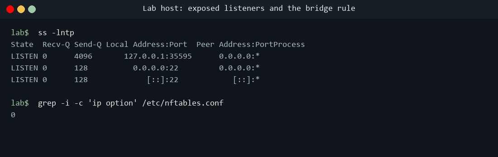

# The CVE-2026-98432 Linux Kernel Flaw and an AI-Written Exploit: A 2026 Case Study

*A TeamStarWolf case study. Published 3 November 2026; every source checked as of that date.*

[All case studies](/case-studies/README.md) · Related: [AI Security](/AI_SECURITY_REFERENCE.md), [Vulnerability Prioritization](/VULNERABILITY_PRIORITIZATION_REFERENCE.md), [AI Threats 2026](/case-studies/AI_THREATS_2026.md), [Notable Incidents](/NOTABLE_INCIDENTS.md)

## Executive summary

In October 2026 the Linux kernel project disclosed CVE-2026-98432, a use-after-free in the IPv4 TCP connection-setup path that a remote, unauthenticated attacker can reach by sending crafted packets to a listening socket. The kernel CNA scored it 9.8, and the upstream fix is two lines. What made this flaw a landmark was not the bug, which is an ordinary memory-safety race of a kind the kernel fixes regularly, but what Anthropic published alongside it: its Frontier Red Team reported that an unreleased internal research model, after initial prompting, wrote a working zero-click remote-root exploit against servers running a Multipath TCP listener, reaching a root shell in under an hour of model time. The exploit itself was never released.

Two facts have to be held apart, and this study keeps them apart throughout. The vulnerability is Confirmed: the kernel project, the GitHub Advisory Database, Red Hat and AWS all describe the same use-after-free and the same `kfree_rcu` fix. The AI-written exploit is Reported: it rests on Anthropic's own account, the code and test configuration were deliberately withheld, and no independent public reproduction had appeared by late October. The significance for a vulnerability management program does not depend on resolving that second question. Whether or not this particular exploit works as described, the disclosure is a credible, dated marker that the time between a memory-corruption CVE landing and a working exploit existing is collapsing toward the length of a lunch break, which changes how fast the prioritization-to-patch loop has to turn.

Evidence grade: the vulnerability is **Confirmed**; the AI-written exploit and its timing are **Reported** (single-source, Anthropic, unreleased and not independently reproduced as of this writing).

### Key facts at a glance

| Field | Value |
|---|---|
| Identifier | CVE-2026-98432 (GitHub advisory GHSA-qp6h-4hvh-qqqc) |
| Class | Use-after-free (CWE-416) from a race condition in IPv4 TCP connection handling |
| CVSS | 9.8 Critical, vector CVSS:3.1/AV:N/AC:L/PR:N/UI:N/S:U/C:H/I:H/A:H (kernel CNA, NVD, Red Hat) |
| EPSS | About 0.46 percent (roughly the 40th percentile) as of early November 2026 |
| Access required | None: remote, unauthenticated, no user interaction |
| Affected | Linux kernel 4.4 and later, IPv4 only; the primary issue does not affect IPv6 |
| Worst outcome | Remote code execution on hosts with a Multipath TCP listener; kernel crash, memory disclosure or corruption otherwise |
| Upstream fix | Two `kfree()` calls changed to `kfree_rcu()`; landed 5 October 2026, backported to maintained stable branches |
| Disclosed | CVE published 15 October 2026; AI-exploit report published by Anthropic 28 October 2026 |
| In the wild | No reported exploitation; not in CISA KEV as of 2 November 2026 |

### Key findings

- **The bug is an unauthenticated remote use-after-free in IPv4 TCP.** CVE-2026-98432 (CVSS 9.8) is a race condition during concurrent processing of a retransmitted TCP connection request or a socket migration. A child socket is handed the request socket's IP options without a copy, and the options can be freed with a plain `kfree()` while the SYNACK path is still reading them under RCU, which is the use-after-free. IPv4 is affected; IPv6 is not affected by the primary issue.
- **The upstream fix is two lines.** The patch converts the two plain `kfree()` calls, in `inet_sock_destruct()` and `tcp_v4_reqsk_destructor()`, to `kfree_rcu()`, so the options are freed only after an RCU grace period, after readers are done. It landed upstream on 5 October 2026 and was backported to the maintained stable branches, and the CVE was published on 15 October 2026.
- **Impact depends on configuration.** On a host with a Multipath TCP listener, researchers reported unauthenticated remote code execution. Without that, the reachable outcome on plain IPv4 TCP is a kernel crash, memory disclosure, or memory corruption, which is a denial of service and a possible stepping stone. Red Hat notes that reliable code execution "requires precise heap control."
- **An AI model reportedly wrote the exploit, fast, with little human steering.** Anthropic's Frontier Red Team reported that an unreleased internal model wrote the MPTCP exploit after initial prompting, taking by its own account "48 minutes to leak a kernel pointer and another five minutes to reach the shell command execution." Anthropic did not publish the exploit, the kernel version, or the configuration it tested, and framed the result as a lab exercise under coordinated disclosure, not an in-the-wild attack.
- **The ordinary triage signals still said "urgent, not on fire."** As of early November 2026 there was no reported exploitation in the wild, the CVE was not in CISA's Known Exploited Vulnerabilities catalog, and the EPSS score sat around 0.46 percent. A 9.8 base score with an AI-exploit headline and a low real-world-use signal is exactly the kind of split a prioritization program has to reconcile rather than resolve by the loudest number.

### Top recommendations

1. Patch the kernel and reboot. Apply your distribution's fixed kernel as soon as it ships and reboot, because a running kernel keeps the vulnerable code until it is replaced. Upstream fixed this on 5 October 2026, but distribution availability lagged by weeks, so confirm your own vendor's status rather than assuming "upstream fixed" means you are fixed.
2. Find your Multipath TCP exposure first. Identify hosts with an MPTCP listener, because those carry the reported remote-code-execution risk rather than denial of service, and prioritize them. Note that disabling MPTCP alone is not a complete fix: the plain IPv4 TCP path remains reachable for the crash-and-corruption outcome.
3. Use the temporary network mitigation only as a bridge. Dropping inbound IPv4 TCP packets that carry IP options (for example with an nftables rule) blunts the common trigger, but vendors are explicit that it is not a substitute for patching, it needs testing, and on container hosts it may not cover pod-to-pod traffic.
4. Reconcile the base score with the real-world signal. Treat a 9.8 with no in-the-wild use, no KEV listing, and a low EPSS as a fast-track-but-verify item: schedule it ahead of routine patching, scope it by exposure (internet-facing, MPTCP), and do not let an AI-exploit headline push it past an actively exploited bug with a lower score.
5. Shorten your own exploit-window assumptions. Plan patch SLAs for critical memory-corruption CVEs on the assumption that a working exploit can exist within hours of disclosure, for defenders and attackers alike, and that scanning your own code and dependencies before an advisory lands is now part of the job.

## Scope and method

This study covers CVE-2026-98432 as disclosed in October 2026 and the AI-exploit claim published alongside it. Sources are the kernel CVE record and GitHub Advisory Database, Red Hat, AWS and other distribution advisories, and Anthropic's own research post for the exploit claim. Each claim carries one of three evidence grades, and the AI-exploit material is held to the same bar as everything else.

| Grade | Meaning |
|---|---|
| Confirmed | The kernel project, a distribution vendor, or a government advisory confirms the vulnerability or the fix |
| Reported | A single source's account, not independently corroborated or reproduced |
| Demonstrated | A research reproduction available for others to check |

## Part 1: the vulnerability in detail

### Where it lives

CVE-2026-98432 lives in the kernel's handling of incoming TCP connections (**Confirmed**: kernel CNA, GitHub Advisory GHSA-qp6h-4hvh-qqqc, Red Hat, AWS). To understand it you need three pieces of how Linux accepts a connection.

First, **IP options**. A TCP/IP packet can carry optional header fields, the IP options, which the sender controls. The kernel parses them into a small `ip_options` structure attached to the socket. Because the sender sets them, they are attacker-controlled input that the kernel keeps and later reads.

Second, **request sockets**. When a SYN arrives on a listening socket, the kernel does not immediately create a full socket. It creates a lightweight request socket to track the half-open connection, and only promotes it to a full child socket when the handshake completes. Since an earlier kernel change (commit `079096f103fa`), request sockets are processed without holding the listener lock, which improved scalability but removed the serialization that used to make the next step safe.

Third, **RCU**, read-copy-update, a kernel pattern where readers take a lightweight `rcu_read_lock()` and writers defer freeing memory until all such readers have finished, a moment called a grace period. RCU only protects a structure if everyone frees it the RCU way; a single plain `kfree()` on an RCU-read structure breaks the guarantee.

### The race

When the handshake completes, `tcp_v4_syn_recv_sock()` builds the child socket and hands it the request socket's `ip_options` by pointer, without making a copy. At almost the same moment, another CPU can be processing a retransmitted SYN for the same request socket and sending a SYNACK. The SYNACK path reads the options while holding only `rcu_read_lock()`, and `ip_options_build()` reads `opt->optlen` twice as it constructs the reply. Because request sockets are no longer under the listener lock, and because TCP child sockets are not marked `SOCK_RCU_FREE`, the child can be destroyed in the middle of that read. On destruction, `inet_sock_destruct()` frees the options with a plain `kfree()`. The concurrent reader is now walking freed memory: a use-after-free, reachable from the network, before any application has seen a byte (**Confirmed**).

A second, related path exists for request-socket migration, used when `net.ipv4.tcp_migrate_req` is enabled or a `BPF_SK_REUSEPORT_SELECT_OR_MIGRATE` program is attached to move half-open connections between listeners (common in zero-downtime restarts of busy servers). The cloned request socket shares the same options pointer, and `tcp_v4_reqsk_destructor()` also frees it with a plain `kfree()`, giving a second way to trigger the same class of bug.

IPv6 is not affected by the primary issue, because `tcp_v6_syn_recv_sock()` duplicates the options rather than sharing them. The migration path has a narrower IPv6 variant tied to options that only CALIPSO sets, and the advisory says that is addressed in a separate patch.

### The trigger and the blast radius

The trigger is a crafted IPv4 TCP packet carrying IP options, sent to a listening socket, with the timing arranged to race a retransmitted SYN; the migration variant additionally needs the migration feature turned on. No credentials and no user interaction are required.

What an attacker gets depends on the target (**Confirmed** for the outcomes, **Reported** for the demonstrated RCE):

- On a host with a **Multipath TCP (MPTCP) listener**, researchers reported a full unauthenticated remote code execution chain. MPTCP's extra connection-management machinery gives the attacker more control over kernel allocations, which is what turns a use-after-free into reliable code execution.
- On a host **without** MPTCP, the reachable outcome on plain IPv4 TCP is a kernel crash (denial of service), kernel memory disclosure, or memory corruption. Red Hat's statement is that reliable code execution "requires precise heap control," which is the honest framing: the worst case is real but not trivial off the MPTCP path.

### The fix

The fix is small and instructive (**Confirmed**). It changes the two offending frees, in `inet_sock_destruct()` and `tcp_v4_reqsk_destructor()`, from `kfree()` to `kfree_rcu()`, so the options structures are released only after an RCU grace period, by which time any reader that entered under `rcu_read_lock()` has finished. The rationale is simply that the readers already use RCU and other option-replacement paths already deferred their frees, so the destructors should too. The change landed upstream on 5 October 2026 and was backported across the maintained stable branches, from the 5.10 series through the current 7.x line. The CVE was published on 15 October 2026.

### Timeline

| Date (2026) | Event |
|---|---|
| 5 October | Two-line `kfree_rcu` fix merged upstream and backported to maintained stable branches |
| 15 October | CVE-2026-98432 published by the kernel CNA and to the GitHub Advisory Database (CVSS 9.8) |
| 16 October | Oracle Linux UEK fixes released via ELSA advisories |
| 28 October | Anthropic's Frontier Red Team publishes the AI-exploit report |
| 30 October | AWS security bulletin published; Amazon Linux fixes available; Red Hat rates it Critical and is expediting fixes |
| 2 November | Still no reported in-the-wild exploitation; not in CISA KEV |

## Part 2: the AI-written exploit, graded carefully

On 28 October 2026 Anthropic's Frontier Red Team published a post describing how an unreleased internal research model found and exploited memory-safety flaws in real software, and CVE-2026-98432 was its headline Linux example (**Reported**: Anthropic). The claim has a specific, checkable shape, which is why it is worth grading rather than repeating or waving away.

### What the model did

Anthropic states that "after initial prompting, Claude wrote an exploit" that lets a remote attacker run commands as root, with no credentials or user interaction, on Linux servers with a Multipath TCP listener. The post attributes the work to "an unreleased, internal research model" and does not name it. The exploit it describes is a two-stage chain, which is the standard shape of a modern kernel exploit:

1. **Defeat KASLR.** Kernel Address Space Layout Randomization hides where kernel code and data sit in memory. The exploit first uses the use-after-free to leak a kernel pointer, which reveals the randomization offset and tells the attacker where everything is.
2. **Gain execution.** With the layout known, the attacker reuses the freed-and-reallocated object to redirect kernel control flow and reach a root shell.

By Anthropic's own account, "it takes 48 minutes to leak a kernel pointer and another five minutes to reach the shell command execution." That figure is Anthropic's measurement of its own run; it is not an independent benchmark.

### What Anthropic withheld, and why

Anthropic reported the vulnerabilities under its coordinated disclosure policy, which it describes as giving developers 90 days to patch and a further 45 days before it discusses details beyond a public advisory. It did not publish the exploit code, the kernel version, or the tested configuration, and it framed the exercise as a lab result rather than an attack. Its stated purpose for publishing was defensive: that enabling defenders with capable models is "critical to giving them a head start on patching systems before attackers do," and that "scanning your own code is more important than ever." This context matters for grading: the omissions are deliberate and responsible, but they are also exactly what prevents independent verification.

### What is missing for a higher grade

As of late October 2026 no independent party had publicly reproduced the exploit, and at least one kernel vendor team reported that it could not. Discovery credit for the specific CVE is also not cleanly stated: the post says "we discovered" a set of kernel findings and separately that "Claude wrote an exploit," without pinning which findings were model-found versus human-found, and the coordinated-disclosure report for this bug is associated with an Anthropic researcher. So the cleanest reading separates three questions:

- Is the vulnerability real and reachable? Yes, **Confirmed** by the kernel project and multiple vendors.
- Did an AI model write a working exploit for it in under an hour? **Reported** by Anthropic, unreleased and unreproduced.
- Did the AI discover the vulnerability in the first place? Not established either way by the public record.

### Why it still matters at "Reported"

Grading the exploit **Reported** is not a dismissal. A capable lab saying, with a dated post and a real CVE number, that a model built a kernel remote-root exploit in under an hour is significant even before anyone reproduces it, because the direction it points is one defenders must plan around. Anthropic's own earlier assessment of a preview model described it chaining two, three and sometimes four vulnerabilities into working exploits against the Linux kernel, so this is a trend line, not a single anecdote. The responsible move for a defender is to act on the part that is already certain (patch), watch for reproduction, and avoid both the hype reading ("AI can now own any server") and the dismissive one ("vendor marketing"). See [the AI Threats 2026 case study](/case-studies/AI_THREATS_2026.md), whose machine-speed-vulnerability-discovery section this disclosure directly extends, and [the AI Security Reference](/AI_SECURITY_REFERENCE.md).

## Part 3: patch status, mitigation and detection

### The patch gap

The upstream fix existed before most organizations could deploy it, which is the usual kernel-CVE gap and the heart of the operational problem (**Confirmed**: distribution advisories, status as of late October to early November 2026):

| Ecosystem | Status |
|---|---|
| Upstream stable | Fixed on 5 October 2026 and backported across maintained stable branches (5.10 series through current 7.x) |
| Debian 12 and 13 | Fixed (DLA and DSA advisories issued) |
| SUSE SLES and openSUSE Leap | Fixed for most streams; some streams still in progress |
| Oracle Linux UEK | Fixed on 16 October 2026 via ELSA advisories |
| Amazon Linux 2 and 2023 | Fixed kernel packages available; some default streams pending |
| AlmaLinux 8, 9, 10 | Patched kernels released, after a period in testing |
| Red Hat Enterprise Linux 8, 9, 10 and OpenShift | Rated Critical (9.8); Red Hat was expediting fixes and evaluating interim OpenShift guidance |
| Rocky Linux 8 to 10 and other RHEL rebuilds | Followed RHEL; no fixed kernel at the time of writing |
| Ubuntu 22.04, 24.04, 26.04, 26.10 | Fix in progress, not yet released |

### Per-platform remediation

The fix is always "run a patched kernel and reboot into it," but the command and the live-patch option differ by platform. Confirm the running kernel with `uname -r` after rebooting, not just the installed package.

| Platform | How to check and remediate |
|---|---|
| Debian / Ubuntu | `uname -r`; `sudo apt-get update && sudo apt-get install --only-upgrade linux-image-generic` (or your flavour's kernel meta-package), then reboot; Ubuntu Pro Livepatch may cover it before the reboot |
| RHEL / Alma / Rocky | `rpm -q kernel`; `sudo dnf upgrade kernel` then reboot; where a live patch is published, `kpatch` can close it without a reboot (confirm coverage for this CVE) |
| Fedora | `sudo dnf upgrade kernel` and reboot |
| SUSE / openSUSE | `sudo zypper up kernel-default` then reboot; SLES Live Patching can bridge the reboot gap where a patch exists |
| Oracle Linux (UEK) | `sudo dnf upgrade kernel-uek` then reboot (UEK fixes shipped 16 October 2026); Ksplice can apply the fix live where available |
| Amazon Linux | `sudo dnf upgrade kernel` (AL2023) or `sudo yum update kernel` (AL2) then reboot; AL2023 instances pinned to a release need version 2023.12.20261102 or later |
| Arch | `sudo pacman -Syu linux` then reboot |
| Containers | Containers share the host kernel, so patch the node, not the image: a container cannot be patched for a kernel CVE. Cordon and drain the node, patch and reboot it, then uncordon |
| Managed Kubernetes | Roll node groups to a patched node image: EKS to a patched AL2023 AMI, GKE and AKS to a patched node image, draining nodes as they cycle |
| MPTCP mitigation | Find listeners with `ss` and check `sysctl net.mptcp.enabled`; disabling MPTCP removes the reported remote-code-execution path but leaves the plain-TCP crash-and-corruption path, so it is a severity reduction, not a fix |
| Network mitigation | As a bridge, drop inbound IPv4 TCP packets carrying IP options at the host or edge (for example an nftables rule), after testing against legitimate traffic; it is not a substitute for patching |

### Two operational traps

First, a kernel fix is not live until the host reboots into the new kernel, so "package updated" is not the same as "no longer vulnerable" for a box that has not been restarted. For fleets that cannot reboot immediately, kernel live-patching (such as the live-patch services the major distributions offer) can close some classes of flaw without a reboot, but live-patch coverage for any given CVE varies and should be confirmed with the vendor rather than assumed; it is a way to buy time, not a replacement for the eventual reboot.

Second, the common temporary mitigation, an nftables rule dropping inbound IPv4 TCP packets that carry IP options, is explicitly a bridge, not a fix: Red Hat and others say it does not replace patching, it needs testing against legitimate traffic (some networks use IP options), and on OpenShift nodes it covers only the host network namespace, not pod-to-pod traffic. Disabling Multipath TCP removes the reported remote-code-execution path but leaves the plain IPv4 TCP crash-and-corruption path reachable, so it reduces severity without closing the hole.

### Detection and hunting

Because there is no reported in-the-wild activity, detection here is mostly about knowing your exposure and watching for the failure modes an unreliable exploit produces (**Confirmed** as general guidance; there are no published campaign indicators to match):

- **Inventory MPTCP listeners first.** These carry the remote-code-execution risk. Modern socket tooling can enumerate MPTCP sockets, and MPTCP is off by default on many distributions, so confirm whether it is enabled and listening before treating a host as worst-case.
- **Watch for kernel instability.** A failed or early-stage exploit against this bug tends to crash the kernel. A rise in kernel oops or panic events referencing the TCP or IPv4 networking paths on an internet-facing host is worth investigating, not just auto-restarting.
- **Flag unusual IP-options traffic.** Legitimate inbound IPv4 TCP with IP options is uncommon on most networks; a spike is a cheap signal, and it is the same traffic the temporary nftables mitigation drops.
- **Key on version and reboot, not just the installed package.** Confirm both that the fixed kernel package is installed and that the host is actually running it.

## How to check your own host

Three short checks tell you where a Linux host stands on CVE-2026-98432: whether the running kernel carries the fix, whether Multipath TCP is in a state that adds the reported remote-code-execution path, and whether an IPv4 TCP listener is reachable at all. Every command in the three checks only reads state; none of them changes the host. Run them in order, because the answer to the first decides how much the other two matter.

The screenshots were captured on a lab host running Kali 2026.2 with kernel 7.1.5 on 3 November 2026. That host was unpatched on that date and no fixed package was available for it yet, so it works through the case of "vulnerable, no fix path, mitigate and watch." Each screenshot is a rendering of the commands' real output with a neutral prompt. Two lines are reshaped for the image: the long `/proc/version` line is wrapped onto two lines, and the `nstat` listing in Check 2 shows its first six counters and then a summary line in place of the remaining 70 (all of them 0). The fixed versions are **Confirmed** from the Debian security tracker and kernel.org as opened on 3 November 2026; the lab readings are the measured output of one host on one date.

### Check 1: the running kernel and its package

```bash
uname -r
cat /proc/version
apt-cache policy linux-image-amd64
```


`uname -r` names the kernel that is running now, which is the one that matters. The end of `/proc/version` carries the distribution's package version for that build (`Kali 7.1.5-1kali1 (2026-07-29)` on the lab host), which is the number to compare against an advisory. `apt-cache policy` shows the kernel package that is installed and the newest one the configured repositories offer (the Candidate). On RPM-based distributions the per-platform table above gives the equivalent commands.

Compare the package version with the fixed versions for your release. For Debian, the security tracker lists these:

| Debian release | Source package | Fixed in | Advisory |
|---|---|---|---|
| 12 (bookworm) | `linux` | 6.1.190-1 | DLA-4841-1 |
| 12 (bookworm) | `linux-6.12` | 6.12.113-1~deb12u1 | DLA-4850-1 |
| 13 (trixie) | `linux` | 6.12.113-1 | DSA-6568-1 |
| unstable (sid) | `linux` | 7.2.10-1 | none listed |

The tracker gives the upstream fix as commit `e3f33b0a1d89d738e2b913dab519226eaf76e15b`, noted against 7.3-rc7. The kernel.org release list on 3 November 2026 showed mainline 7.4-rc1, stable 7.3.1, 7.2.15 marked end of life, and the longterm series 6.18, 6.12, 6.6, 6.1, 5.15 and 5.10. No 7.1 series appears on it, so there is no upstream 7.1 stable branch to carry a backport: a host on a 7.1.x kernel reaches the fix by moving to a kernel from a newer series.

- **What vulnerable looks like:** the running package version is below the fixed version for your release, or the kernel belongs to a series that no longer receives fixes. If Installed and Candidate are the same and both are below the fix, no fixed kernel is available from your configured repositories yet. The lab host shows exactly this: Installed and Candidate are both `7.1.5-1kali1`, a 7.1 build with no newer package on offer.
- **What fixed looks like:** the version at the end of `/proc/version` is at or above your release's fixed version (on Debian 13, `6.12.113-1` or later), and `uname -r` after a reboot names that kernel. A Candidate above Installed means the fix is waiting to be installed: install it and reboot (see After patching below).

### Check 2: Multipath TCP state

```bash
cat /proc/sys/net/mptcp/enabled
grep MPTCP /boot/config-7.1.5+kali-amd64
ss -Mlan
nstat -az | grep -i mptcp
```

On your own host, put the name `uname -r` printed in place of `7.1.5+kali-amd64` in the second command, or write the path as `/boot/config-"$(uname -r)"`.


The four commands answer the three questions from [the Multipath TCP case study](/case-studies/MPTCP_ATTACK_SURFACE_2026.md#part-3-how-to-check-your-exposure-and-why): is MPTCP compiled in (`CONFIG_MPTCP=y`), is it enabled (`1` in the sysctl file), and is anything using it (`ss -Mlan` lists MPTCP sockets in every state, and `nstat -az` prints the kernel's MPTCP counters since boot, zero values included). On the lab host MPTCP is compiled in and enabled, but `ss -Mlan` prints only its header row and every MPTcpExt counter in the output is 0: the feature is switched on and has not been used since boot. Question 3 of that study adds two force-enable checks (the `mptcpize` search and the `bpftool` listing); they were not part of the lab capture.

- **What the reported remote-code-execution path needs:** a row in `ss -Mlan` in the LISTEN state. Anthropic's exploit report and the AWS bulletin tie the remote-code-execution outcome to a host with a Multipath TCP listener. Nonzero counters show MPTCP traffic has been seen since boot, so a host with them deserves a closer look even if no listener shows at the moment you check.
- **What an empty socket list means:** the configuration in which the remote-code-execution exploit was reported is absent at that moment. The plain IPv4 TCP path to a crash, memory disclosure or corruption is still there, because the flaw is in ordinary IPv4 TCP connection handling, not in MPTCP. Red Hat's bulletin puts it directly: a result with no MPTCP listeners "should be treated as informational rather than as reassurance."
- **What reduced looks like:** `0` in `/proc/sys/net/mptcp/enabled` (see If you cannot patch yet below), and no MPTCP sockets. That lowers the worst case; only the patched kernel fixes the flaw.

### Check 3: exposed IPv4 listeners and the bridge rule

```bash
ss -lntp
grep -i -c 'ip option' /etc/nftables.conf
```



`ss -lntp` lists the TCP sockets in the LISTEN state. A local address of `0.0.0.0` means the socket accepts IPv4 connections on every interface, which is the input the flaw needs: an inbound IPv4 connection request. A `127.0.0.1` listener is reachable only from the host itself. A local address of `*` is a dual-stack listener: it is an IPv6 socket that also accepts IPv4 connections (as IPv4-mapped addresses), and those connections go through the kernel's IPv4 TCP path, so count a `*` row as an IPv4 listener. The `[::]` rows are IPv6-only sockets, and IPv6 is what the kernel's description of the fix says is not affected by the primary issue. On the lab host, port 22 (SSH) listens on `0.0.0.0`, so the plain IPv4 TCP path is reachable from the network. The Process column is empty in this capture because `ss` was run without root; run it with `sudo` to see which program owns each listener.

The `grep` counts lines in the persistent nftables configuration that mention IP options; `0` means no such rule is written there. Red Hat's bridge rule (below) lives in its own table, matches on `ip hdrlength` rather than the words "ip option," and does not survive a reboot, so check it live with the bulletin's `sudo nft list table inet cve_2026_98432` once you have applied it.

- **What vulnerable looks like:** an unpatched kernel from Check 1 with any IPv4 listener on `0.0.0.0`, `*` or a routable address, and no IP-options filter in front of it. The lab host is in this state.
- **What mitigated looks like:** the same listeners, with Red Hat's table loaded (or an equivalent filter at the network edge) until the fixed kernel is running.

### If you cannot patch yet

Red Hat's bulletin RHSB-2026-016 gives a temporary nftables table that drops inbound IPv4 TCP packets carrying IP options, the input the flaw requires. Save it as `cve-2026-98432.nft`:

```
table inet cve_2026_98432 {
    chain input {
        type filter hook input priority -310; policy accept;
        ip protocol tcp ip hdrlength > 5 counter drop
    }
}
```

Then validate it, load it, and confirm it is in place, using the bulletin's commands:

```bash
sudo nft --check --file cve-2026-98432.nft
sudo nft --file cve-2026-98432.nft
sudo nft list table inet cve_2026_98432
```

The match works because `ip hdrlength` is the IPv4 header length field, counted in 32-bit words with a minimum of 5 for a header with no options (RFC 791), so a value above 5 means the packet carries IP options. Ordinary TCP options sit in the TCP header and are not affected. Priority -310 places the chain ahead of the raw (-300) and connection-tracking (-200) stages in the nftables priority list. Red Hat attaches four conditions to the rule:

- It reduces exposure but cannot fully prevent exploitation, and it is not a substitute for patching. The kernel update is the only complete fix.
- Test it against your own traffic in a non-production environment first, because some networks use IP options legitimately.
- It is not persistent. Reapply it after any reboot that happens before the fixed kernel is installed.
- On OpenShift nodes it filters only the host network namespace, not pod-to-pod traffic; filtering at the network boundary in front of the cluster does not have that limit.

On a host that does not use Multipath TCP (Check 2 shows no MPTCP sockets, and [the force-enable checks](/case-studies/MPTCP_ATTACK_SURFACE_2026.md#question-3-is-anything-actually-using-it) find no `mptcpize` wrapper or MPTCP eBPF program), you can also switch it off to remove the reported remote-code-execution path. At runtime:

```bash
sudo sysctl -w net.mptcp.enabled=0
```

And persisted across reboots:

```bash
echo 'net.mptcp.enabled = 0' | sudo tee /etc/sysctl.d/99-disable-mptcp.conf
sudo sysctl --system
```

Red Hat notes that the setting governs only sockets created after the change, so a service that was already listening with MPTCP has to be restarted, and that the host stays affected through the plain IPv4 TCP path either way. MPTCP is disabled in Red Hat Enterprise Linux's default configuration, so on a default system the setting changes nothing. Confirm non-use first: [the Multipath TCP case study](/case-studies/MPTCP_ATTACK_SURFACE_2026.md#the-gate-confirm-non-use-first) explains why a service that requests MPTCP fails outright once it is off.

For the lab host on 3 November 2026 this was the whole plan: with no fixed package to install, load the filter, turn MPTCP off once the force-enable checks (which were not part of the lab capture) also confirm that nothing uses it, and re-run Check 1 until a fixed kernel appears.

### After patching

Install the fixed kernel with the command from the per-platform table, then reboot, because the running kernel keeps the vulnerable code until it is replaced. After the reboot, re-run Check 1: `uname -r` must name the new kernel, and the end of `/proc/version` must show a package version at or above the fixed one. A fixed kernel that is installed but not running still leaves the host vulnerable. Once the fixed kernel is running, remove the bridge rule with the bulletin's command:

```bash
sudo nft delete table inet cve_2026_98432
```

Leave `net.mptcp.enabled=0` in place on hosts that never needed MPTCP; [the Multipath TCP case study](/case-studies/MPTCP_ATTACK_SURFACE_2026.md) makes the case for keeping it as a standing control.

## Part 4: the vulnerability-management lens

This CVE is a compact teaching case for how to triage in 2026, because its signals point in different directions and all of them are correct at once.

- **CVSS said "as bad as it gets."** A 9.8 with network access, no privileges and no user interaction is the maximum-urgency shape. On its own it argues for emergency patching everywhere.
- **EPSS and KEV said "not yet."** An EPSS around 0.46 percent and no KEV listing say that, despite the score and the headline, no one was observed using it. That argues against dropping everything, especially ahead of a lower-scored bug that is actively exploited.
- **Exposure said "only some of you."** The worst outcome needs an MPTCP listener; most hosts face denial of service, not remote code execution. Asset context changes the real risk more than the base score does.

The program move is to carry all three signals and let them combine, which is the core argument of [the Vulnerability Prioritization Reference](/VULNERABILITY_PRIORITIZATION_REFERENCE.md): fast-track this ahead of routine patching, scope the emergency to internet-facing and MPTCP-enabled hosts, use the network mitigation as a bridge where a reboot must wait, and do not let the AI-exploit headline reorder a queue that still has an actively exploited, lower-scored bug in it. The AI angle changes one planning assumption, not the triage math: shorten the exploit-window your SLAs assume.

## Cross-cutting themes

- **The exploit-availability window is the real clock.** Prioritization has always raced the moment a public exploit appears. This disclosure is a dated data point that, for memory-corruption bugs, that moment may now arrive within hours of the CVE, from an AI as readily as from a human researcher. Patch SLAs and emergency-change processes should be sized for that, not for the weeks exploit development used to take. See [the Vulnerability Prioritization Reference](/VULNERABILITY_PRIORITIZATION_REFERENCE.md).
- **Base severity and real-world risk diverged, and both were right.** A uniform 9.8 said the bug is as bad as bugs get in principle; the empty KEV entry and low EPSS said no one was using it yet; the MPTCP condition said the worst outcome only applied to some hosts. A program that collapses these into one number, in either direction, mis-triages. The job is to carry all three and act on their combination.
- **AI capability claims deserve the same evidence grading as everything else.** The right response to a vendor saying its model built a kernel exploit is neither to treat it as proven nor to dismiss it as marketing, but to grade it (single-source, unreproduced, Reported), act on the part that is already certain (the patch), and watch for reproduction. This is the same Confirmed-versus-Reported discipline the rest of the library applies to threat claims. See [the AI Security Reference](/AI_SECURITY_REFERENCE.md) and [Fuzzing and Vulnerability Research](/FUZZING_VULNERABILITY_RESEARCH.md).
- **Defenders can run the same tools.** If a model can find and chain memory-safety bugs at this speed, the defensive implication Anthropic itself drew is that scanning your own code and dependencies before an advisory lands is now table stakes, not an advanced practice. The capability is dual-use; the question is who runs it first on your code.
- **Small fixes, large fleets.** The repair was two lines upstream, and the exposure still spanned the whole Linux ecosystem for weeks because of backporting, testing and the reboot requirement. Memory-safety classes like this one are also why the broader push toward memory-safe systems languages matters: the fix for the instance is quick, but the supply of the instances is the problem.

## Sources

- The Linux kernel CVE record for CVE-2026-98432 and the GitHub Advisory Database entry GHSA-qp6h-4hvh-qqqc, including the root-cause description, the `kfree_rcu` fix, the CVSS 9.8 vector, the EPSS figure, and the IPv6 note.
- Red Hat's vulnerability page and security bulletin RHSB-2026-016 for CVE-2026-98432, for the Critical rating, the affected Red Hat Enterprise Linux and OpenShift versions, the "requires precise heap control" statement, and the nftables mitigation guidance.
- The AWS security bulletin for CVE-2026-98432, for the affected-version range, the Multipath TCP remote-code-execution statement, its statement that there was no evidence of exploitation in the wild, and the Amazon Linux fix status.
- Distribution advisories from Debian, SUSE, Oracle, AlmaLinux, Rocky Linux and Ubuntu, and vendor trackers, for the patch-status matrix.
- Anthropic's Frontier Red Team research post, "Discovering and exploiting vulnerabilities in critical, real-world software with Claude," for the exploit claim, the model description, the timing figures, the coordinated-disclosure framing, and the earlier preview-model assessment of multi-vulnerability chaining; the exploit, kernel version and configuration were not published, and the claim was not independently reproduced as of this writing.
- The Debian security tracker entry for [CVE-2026-98432](https://security-tracker.debian.org/tracker/CVE-2026-98432), opened 3 November 2026, for the fixed versions per Debian release (bookworm `linux` 6.1.190-1 via DLA-4841-1, bookworm `linux-6.12` 6.12.113-1~deb12u1 via DLA-4850-1, trixie `linux` 6.12.113-1 via DSA-6568-1, and unstable `linux` 7.2.10-1), the upstream fix commit `e3f33b0a1d89d738e2b913dab519226eaf76e15b` noted against 7.3-rc7, and the kernel's description of the fix, including the note that IPv6 is not affected by the primary issue.
- The kernel.org release list ([releases.json](https://www.kernel.org/releases.json)), opened 3 November 2026, for the maintained series on that date: mainline 7.4-rc1, stable 7.3.1, 7.2.15 marked end of life, and longterm 6.18, 6.12, 6.6, 6.1, 5.15 and 5.10, with no 7.1 series listed.
- Red Hat security bulletin RHSB-2026-016, reopened 3 November 2026, for the `cve_2026_98432` nftables table and its check, load, list and delete commands, the conditions attached to it (not a substitute for patching, test first, not persistent, host network namespace only on OpenShift), and its statements that disabling MPTCP governs only sockets created afterwards, that MPTCP is disabled in the default Red Hat Enterprise Linux configuration, and that a result with no MPTCP listeners is informational rather than reassurance.
- The nftables wiki [quick reference](https://wiki.nftables.org/wiki-nftables/index.php/Quick_reference-nftables_in_10_minutes), for the `ip hdrlength` match and the hook priority values, and [RFC 791](https://www.rfc-editor.org/rfc/rfc791), for the IPv4 header length field (IHL, counted in 32-bit words, minimum 5).
- The iproute2 source for `ss` ([misc/ss.c](https://github.com/iproute2/iproute2/blob/main/misc/ss.c)) and the Linux kernel's IPv6 TCP code ([net/ipv6/tcp_ipv6.c](https://github.com/torvalds/linux/blob/master/net/ipv6/tcp_ipv6.c)), both opened 3 November 2026: `inet_addr_print` prints an IPv6 any-address listener as `*` unless the socket is IPv6-only, in which case it prints `[::]`, and `tcp_v6_conn_request` and `tcp_v6_syn_recv_sock` hand IPv4 packets arriving on an IPv6 socket to `tcp_v4_conn_request` and `tcp_v4_syn_recv_sock`.
- Command output captured on a lab host running Kali 2026.2 with kernel 7.1.5 on 3 November 2026, for the three screenshots and the lab readings in How to check your own host.

## Related references

- [AI Security Reference](/AI_SECURITY_REFERENCE.md)
- [MITRE ATLAS Reference](/ATLAS_REFERENCE.md)
- [Fuzzing and Vulnerability Research](/FUZZING_VULNERABILITY_RESEARCH.md)
- [Vulnerability Prioritization Reference](/VULNERABILITY_PRIORITIZATION_REFERENCE.md)
- [The AI Threats 2026 Case Study](/case-studies/AI_THREATS_2026.md)
- [Notable Incidents](/NOTABLE_INCIDENTS.md), [Vulnerability Management Reference](/VULNERABILITY_MANAGEMENT_REFERENCE.md)
