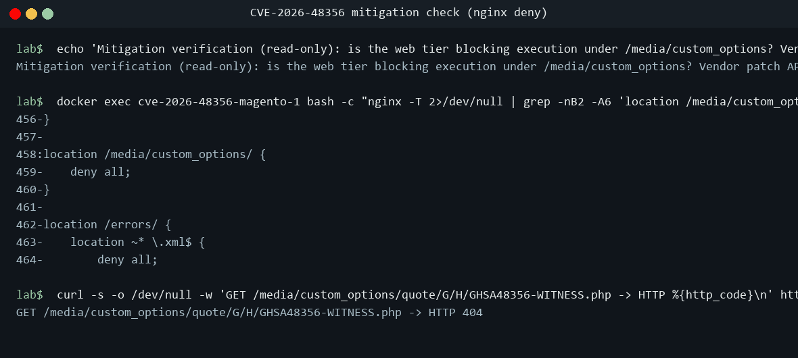

# Magento and Adobe Commerce, CVE-2026-48356: Lab-Verified Exposure and Fix

*A TeamStarWolf case study. Published 4 November 2026; every source checked as of that date.*

[All case studies](/case-studies/README.md) · Related: [CVE Reference](/CVE_REFERENCE.md), [Notable Incidents](/NOTABLE_INCIDENTS.md), [Vulnerability Prioritization](/VULNERABILITY_PRIORITIZATION_REFERENCE.md), [Web Application Security](/WEB_APPLICATION_SECURITY_REFERENCE.md), [Triage a CVE](/guides/TRIAGE_A_CVE.md), [Ghostcat](/case-studies/GHOSTCAT_CVE_2020_1938.md), [ProFTPD mod_copy](/case-studies/PROFTPD_MOD_COPY_CVE_2015_3306.md)

<!-- meta:start (written by scripts/build_doc_meta.py from data/doc_meta.yaml; do not edit) -->

<table class="tsw-meta-card">
<tr><th scope="row" align="left" valign="top">Who this is for</th><td>

Vulnerability management leads, e-commerce platform owners, Magento and Adobe Commerce administrators and security engineers

</td></tr>
<tr><th scope="row" align="left" valign="top">Level</th><td>

Intermediate

</td></tr>
<tr><th scope="row" align="left" valign="top">Reading time</th><td>

About 30 min (6,992 words at 230 words a minute)

</td></tr>
<tr><th scope="row" align="left" valign="top">Read this when</th><td>

You need the facts of the PolyShell file-upload flaw CVE-2026-48356, you run Magento Open Source or Adobe Commerce, or you want to find, fix and hunt for it on your own stores

</td></tr>
<tr><th scope="row" align="left" valign="top">Start at</th><td>

[Executive summary](#executive-summary), [Part 2: what the lab showed](#part-2-what-the-lab-showed), [Part 3: find and fix it on real hosts](#part-3-find-and-fix-it-on-real-hosts)

</td></tr>
</table>

<details class="tsw-meta-more"><summary>More about this page (pairs with, last reviewed)</summary>

<table class="tsw-meta-card">
<tr><th scope="row" align="left" valign="top">Pairs with</th><td>

[CVE Reference](/CVE_REFERENCE.md), [Web Application Security Reference](/WEB_APPLICATION_SECURITY_REFERENCE.md), [Vulnerability Prioritization Reference](/VULNERABILITY_PRIORITIZATION_REFERENCE.md), [Ghostcat, CVE-2020-1938: The Tomcat AJP File Read in the Lab](/case-studies/GHOSTCAT_CVE_2020_1938.md)

</td></tr>
<tr><th scope="row" align="left" valign="top">Last reviewed</th><td>

No review recorded yet

</td></tr>
</table>

</details>

<!-- meta:end -->

## Executive summary

Magento Open Source and its commercial sibling Adobe Commerce are PHP e-commerce platforms, and their storefronts expose a REST API that lets an anonymous shopper build a cart. CVE-2026-48356, which the researchers at Sansec found and named PolyShell, sits in that cart. An unauthenticated guest-cart call accepts a file attached to a product's custom option and writes it to `pub/media/custom_options/quote/` with no check on its extension, so a file named `.php` that starts with an image header lands on the web server's disk (Confirmed [1][10]). Whether that file then runs as code depends on the web server configuration in front of Magento, including the configuration each Magento release ships (Confirmed [10]).

The public record is unusually split. Sansec published its advisory on 17 March 2026 (Confirmed [10]) and reported attacks from 19 March, including an automated wave that compromised 471 stores in one hour on 30 March (Reported (Sansec) [10][11]). CISA's KEV listing and SSVC entry confirm that the flaw was exploited in the wild (Confirmed [3][5]). Adobe's bulletin APSB26-73 arrived on 14 July 2026 with isolated patch files, a Priority 2 rating and a statement that Adobe was not aware of exploits in the wild, a statement it still carried when CISA added the CVE to the Known Exploited Vulnerabilities catalog on 27 October 2026 (Confirmed [1][5]). The scores disagree too: 9.6 in the bulletin and the GitHub advisory, 9.3 in the CVE record and NVD (Confirmed [1][3][4][6]).

The lab run behind this study, on 4 November 2026, installed Magento Open Source 2.4.8-p5, an affected release, on loopback. It showed the flaw as a file write: an anonymous guest-cart call stored a 69-byte `.php` file beginning with `GIF89a` under `custom_options/quote/`, and the image's stock nginx rule refused to serve it, so no PHP ran (Demonstrated [26][27][28]). The lab did not test the fixed state, because Adobe's isolated patch was not on the lab host; this study makes no vulnerable-versus-fixed comparison (Demonstrated [26][28]).

Evidence grade: the flaw, the affected and fixed versions, the KEV listing, the fact of exploitation and the patch procedure are **Confirmed** from Adobe, the CVE record, NVD, CISA and Sansec's technical advisory. The file write, the blocked execution and the log pattern are **Demonstrated** in the lab. Sansec's attack dates and store counts, its statement that Magento 2.4.9 already contains the fix, and its 82 percent figure are **Reported**, because no second source corroborates them. Where this study draws its own conclusion, it is labelled **Inferred**.

### Key facts at a glance

| Field | Value |
|---|---|
| Identifier | CVE-2026-48356, "PolyShell" (Sansec's name); GitHub advisory GHSA-p3ch-8535-fp8j [3][6][10] |
| Products | Adobe Commerce, Adobe Commerce B2B, Magento Open Source, Adobe Commerce Events [1] |
| Weakness | CWE-434, Unrestricted Upload of File with Dangerous Type (Adobe, CVE record, NVD, KEV, GHSA) [1][3][4][5][6] |
| CVSS 3.1 | 9.6, `AV:N/AC:L/PR:N/UI:R/S:C/C:H/I:H/A:L` (bulletin, GHSA); 9.3, same vector with `A:N` (CVE record, NVD) [1][3][4][6] |
| Adobe impact and rating | Critical, "Privilege escalation", no authentication required, Priority 2 [1] |
| Entry point | Unauthenticated `POST /V1/guest-carts/:cartId/items` and `PUT /V1/guest-carts/:cartId/items/:itemId`; GraphQL is not vulnerable [10] |
| Affected (Open Source) | 2.4.9, 2.4.8-p5, 2.4.7-p10, 2.4.6-p15 and earlier [1] |
| Fixed | The 2.4.x-2026-jul isolated patch for each release line; B2B 1.x-2026-jul; Commerce Events 1.21.0 [1][7] |
| Discovered and disclosed | Sansec, advisory 17 March 2026; Adobe credits no researcher [1][10] |
| Exploited | Known exploited per CISA KEV and SSVC (Confirmed) [3][5]; from 19 March 2026 and 471 stores in one hour on 30 March 2026 per Sansec (Reported) [10][11] |
| Vendor bulletin | APSB26-73, published 14 July 2026, last updated 11 August 2026 [1] |
| CISA KEV | Added 27 October 2026, due 10 November 2026, known ransomware use Unknown [5] |
| CISA SSVC | Exploitation active, Automatable no, Technical Impact total [3] |
| Lab result | File write Demonstrated on 2.4.8-p5; execution blocked by the stock nginx deny; fixed state not tested [26][28] |

### Key findings

- **The flaw is a file write that anyone can trigger.** The guest-cart item routes accept an embedded `file_info` object inside a custom option and store it under `pub/media/custom_options/quote/`. The upload is not tied to the product's real option ids, runs even when the product has no file option, and has no extension check beyond `getimagesizefromstring`, which a polyglot passes (Confirmed [10]). The lab reproduced the write with an anonymous cart: the add-item call returned HTTP 200 and the file appeared on disk, owned by `www-data` (Demonstrated [26]).
- **Code execution is a property of the web tier.** Sansec says the upload becomes code execution on stock nginx with Magento 2.0.0 to 2.2.x, on any version whose nginx hands every `.php` file to FastCGI, and on Apache before 2.3.5 without `php_flag engine 0` (Confirmed [10]). The lab image carried the upstream nginx deny for `/media/custom_options/`, and a request for the uploaded file was refused, so PHP did not run (Demonstrated [27][28]). Blocking the directory stops execution, not the upload (Confirmed [10]).
- **Attackers were four months ahead of the bulletin.** Sansec saw first probing on 16 March, first attacks on 19 March, mass scanning of 23 percent of the stores it protects on 23 March, and the 471-store wave on 30 March (Reported (Sansec) [10][11]). Adobe's bulletin came on 14 July, 117 days after the first attacks Sansec reported (Inferred from [1][10]).
- **The vendor and the government disagree on exploitation.** The bulletin still says Adobe is not aware of exploits in the wild and keeps Priority 2, which Adobe defines as no known attacks (Confirmed [1][2]). CISA lists the CVE as known exploited, and its SSVC entry records exploitation as active (Confirmed [3][5]). The rating predates the KEV listing and no longer matches it (Inferred [2][5]).
- **The fix ships as patch files, not packages.** Adobe publishes one isolated patch ZIP per release line, with no Composer packages, and requires the store to be on the latest security patch level for its line first (Confirmed [7]). No public commit in `magento/magento2` names the fix (Confirmed [13]).
- **The campaign outlived the patch.** On 24 October 2026 Sansec tied a CMS-block loader campaign on `deepveindrilling.com` to earlier PolyShell uploads, with 83 stores hit in that wave and 953 since July 2025 (Reported (Sansec) [12]). Patching closes the door; it does not remove what came through it.

### Top recommendations

1. **Patch to the 2026-jul build for your line.** Move to the latest security patch release for your line, then apply the matching APSB26-73 isolated patch from Adobe's KB article KA-37421 and confirm it with the Commerce Version Tool shipped in the ZIP. On Adobe Commerce on cloud infrastructure, check `vendor/bin/magento-patches -n status` instead and do not apply the patch twice (Confirmed [7]). The KEV due date is 10 November 2026 (Confirmed [5]).
2. **Treat 2.4.9 as affected.** Sansec says 2.4.9 GA contains the fix, but Adobe, the CVE record and NVD all list 2.4.9 as affected and Adobe ships a 2.4.9-2026-jul patch. Follow Adobe (Reported [10]; Confirmed [1][3][4]).
3. **Confirm the web tier refuses to run code from media folders.** On nginx, the `/media/custom_options/` deny must sit ahead of any PHP location block (Confirmed [10][14]); on Apache, the folder's `.htaccess` must deny access and disable PHP (Reported [10]). This blocks execution only, so it bridges to the patch and does not replace it.
4. **Hunt before you close the ticket.** Any file other than `.htaccess` under `pub/media/custom_options/` or `pub/media/customer_address/`, any `accesson.php`, and the strings `fpCode`, `se_referrer` or `localStorage.getItem` in CMS blocks or pages are strong indicators of compromise (Confirmed [10][12]). If you find them, review `admin_user` and rotate database, admin and API credentials (Confirmed [12]).
5. **Filter the API call if you cannot patch this week.** Sansec says only a WAF rule on the guest-cart item calls stops the upload itself (Confirmed [10]). Default access logs do not record request bodies, so detecting `file_info` in those calls needs WAF or reverse-proxy body logging (Inferred [24]).

## Scope and method

This study covers CVE-2026-48356 in Adobe Commerce, Adobe Commerce B2B, Magento Open Source and Adobe Commerce Events, from Sansec's March 2026 disclosure through the KEV listing of 27 October 2026, and a lab run on 4 November 2026. It draws on Adobe's bulletin, priority definitions and patch documentation; the CVE record, NVD, the CISA KEV feed and the GitHub advisory; Sansec's three research posts; the `magento/magento2` repository; the MITRE ATT&CK, CWE, CAPEC and D3FEND pages; the library's own data files; and the lab captures. Every source was opened on 4 November 2026.

| Grade | Meaning |
|---|---|
| Confirmed | A primary source was opened: Adobe, the CVE record, NVD, CISA, GitHub, the MITRE page itself, or Sansec's advisory for the technical details of the flaw it found |
| Reported | A single source's account of in-the-wild activity, not independently corroborated or reproduced (Sansec's attack dates and counts read Reported (Sansec)), or a claim that conflicts with the vendor record, carried as the source states it |
| Demonstrated | Reproduced in the TeamStarWolf lab run of 4 November 2026; the capture file is named |
| Inferred | This study's own reasoning from the cited facts, labelled where it appears |

Sansec is the only first-hand source for in-the-wild activity. CISA's KEV listing and SSVC entry corroborate that exploitation happened (Confirmed [3][5]), but no second source corroborates Sansec's dates and counts, so those are graded Reported (Sansec), as the case-studies README defines Reported. Sansec's technical description of the flaw it found is graded Confirmed. Adobe's page at `adobe.com/trust` was read for the bulletin; Akamai's own page on its WAF protection was not opened.

The lab run kept to these rules: Docker targets bound to loopback, short quotes from the captures, version checks and differing observables shown, and proof-of-concept steps described in one sentence rather than reproduced. The screenshots are renderings of the real command output with the lab host anonymized and a neutral prompt.

## Part 1: the flaw and the public record

### What the flaw is

Magento lets a merchant attach custom options to a product, and one option type is a file the shopper uploads (Inferred). When a shopper adds that product to a cart, the uploaded file is stored under `pub/media/custom_options/quote/` (Confirmed [10]).

Sansec found that the anonymous REST routes for guest carts, `POST /V1/guest-carts/:cartId/items` and `PUT /V1/guest-carts/:cartId/items/:itemId`, accept a `file_info` object inside a custom option and write it to that folder, with three checks missing (Confirmed [10]):

- The option id in the request is not validated against the product's own options.
- The upload runs even when the product has no file option at all.
- Nothing restricts the extension. The only content check is `getimagesizefromstring`, and a polyglot file, a valid image header followed by other content, passes it.

Sansec says GraphQL is not vulnerable (Confirmed [10]). Adobe classifies the flaw as CWE-434, Unrestricted Upload of File with Dangerous Type, and the CVE record, NVD (with the CWE supplied by `psirt@adobe.com`), KEV and the GitHub advisory all agree (Confirmed [1][3][4][5][6]).

### When the file becomes code

A file on disk is not yet code execution. It runs only if the web server hands requests for it to PHP. Sansec lists three configurations where that happens (Confirmed [10]):

- stock nginx with Magento 2.0.0 to 2.2.x;
- any Magento version behind an nginx configuration that passes every `.php` file to FastCGI;
- Apache with Magento before 2.3.5, unless `php_flag engine 0` is set for the folder.

Current upstream Magento ships the guard. The `nginx.conf.sample` on the 2.4-develop branch carries a `location /media/custom_options/` deny and a regex deny that covers `^/pub/media/(...custom_options...)`, and `pub/media/custom_options/.htaccess` carries `Require all denied` (Confirmed [14]). Sansec stresses that blocking web access to the folder does not stop the upload itself (Confirmed [10]).

The attack preconditions are short: a storefront reachable over the network with the REST API exposed, no credentials (guest carts need none), and one sellable product to add to a cart (Inferred from [1][10]).

### Scores and their disagreements

| Source | Score | Vector | Impact wording |
|---|---|---|---|
| Adobe bulletin APSB26-73 | 9.6 Critical | `CVSS:3.1/AV:N/AC:L/PR:N/UI:R/S:C/C:H/I:H/A:L` | Privilege escalation; no authentication required [1] |
| GitHub advisory GHSA-p3ch-8535-fp8j | 9.6 critical | Same as the bulletin | Unreviewed, no package ranges [6] |
| CVE record (Adobe as CNA) | 9.3 Critical | Same with `A:N` | Arbitrary code execution; a victim visits a crafted URL; scope changed [3] |
| NVD (`nvd@nist.gov` Primary, `psirt@adobe.com` Secondary) | 9.3 Critical | Same with `A:N` | Status Analyzed [4] |

Three things in that table need a reader's attention.

- **The split is bulletin against record, not Adobe against NVD.** Adobe's own CNA entry in the CVE record scores 9.3 with `A:N`, while Adobe's bulletin scores 9.6 with `A:L` (Confirmed [1][3]).
- **The impact words differ.** The bulletin says privilege escalation; the CVE record and NVD say arbitrary code execution (Confirmed [1][3][4]).
- **`UI:R` does not describe the upload.** The vector says user interaction is required, yet the upload needs no user at all, and Sansec reports that attackers fully automated it (Reported (Sansec) [10][11]). The most likely reading is that `UI:R` scores the downstream victim, a shopper or admin served the uploaded content, not the upload step (Inferred [3][10]).

The CISA ADP Vulnrichment block in the CVE record gives the operational view: Exploitation active, Automatable no, Technical Impact total. Its references are Sansec's mass-wave and `deepveindrilling` reports and the KEV entry (Confirmed [3]). "Automatable no" sits in tension with Sansec's account of a fully automated wave; one plausible reading is that the code-execution step depends on each target's web tier (Inferred [3][10][11]).

### Affected and fixed versions

| Product | Affected (Adobe) | Fixed (Adobe isolated patch builds) |
|---|---|---|
| Adobe Commerce | 2.4.9; 2.4.8-p5, 2.4.7-p10, 2.4.6-p15, 2.4.5-p17, 2.4.4-p18 and earlier | 2.4.9-2026-jul to 2.4.4-2026-jul, one per line |
| Adobe Commerce B2B | 1.5.3; 1.5.2-p5, 1.4.2-p10, 1.3.4-p17, 1.3.3-p18 and earlier | 1.5.3-2026-jul to 1.3.3-2026-jul, one per line |
| Magento Open Source | 2.4.9; 2.4.8-p5, 2.4.7-p10, 2.4.6-p15 and earlier | 2.4.9-2026-jul to 2.4.6-2026-jul, one per line |
| Adobe Commerce Events | 1.6.0 to 1.20.0 | 1.21.0 |

Source: APSB26-73 (Confirmed [1]). NVD's CPE configuration matches: Commerce 2.4.4 to 2.4.9, Commerce B2B 1.3.3 to 1.5.3, Magento Open Source 2.4.6 to 2.4.9, and I/O Events for Commerce from 1.6.0 up to but not including 1.21.0 (Confirmed [4]). The bulletin covers 14 CVEs in total, 8 Critical, 4 Important and 2 Moderate, and every solution row carries Priority 2 (Confirmed [1]). The lab's Magento Open Source 2.4.8-p5 is in the affected range (Confirmed [1]).

### How the fix shipped

Adobe ships the fix as isolated patch files only, with no Composer packages. KB article KA-37421, released 14 July 2026 and updated 20 August 2026, gives one ZIP per release line, for example `2-4-8-p5-jul-2026.zip` for the 2.4.8 line, and requires a store to be on the latest security patch level for its line before applying it. The KB names no CVE (Confirmed [7]).

No public fix commit was found. The July 2026 commit list and the tags of `magento/magento2` (2.4.8-p5, 2.4.9-alpha1 to 2.4.9, 2.4.10-alpha1) were read, and none names the PolyShell fix; a diff between 2.4.9-alpha2 and alpha3 was not checked (Confirmed [13]).

Sansec's account of the fix differs from Adobe's. Sansec cites APSB25-94 for a fix in the 2.4.9 pre-release branch (2.4.9-alpha3), says Magento 2.4.9 GA, released 12 May 2026, contains the fix, and records that APSB26-73 backported it to older lines on 14 July 2026; its 12 May update said there was no backport at that time (Reported [10]). Adobe, the CVE record and NVD all list 2.4.9 as affected and Adobe ships 2.4.9-2026-jul (Confirmed [1][3][4]). The conflict is unresolved. For patching decisions, follow Adobe's list.

### Timeline

| Date | Event | Source | Grade |
|---|---|---|---|
| 2026-03-16 | First probing seen by Sansec | [10] | Reported (Sansec) |
| 2026-03-17 | Sansec publishes the PolyShell advisory | [10] | Confirmed |
| 2026-03-19 | First attacks in the wild, per Sansec | [10] | Reported (Sansec) |
| 2026-03-23 | Mass scanning: 23 percent of Sansec-protected stores targeted, more than 50 probing IPs | [10] | Reported (Sansec) |
| 2026-03-27 | Akamai adds WAF protection, per Sansec; Akamai's page not opened | [10] | Reported |
| 2026-03-30 | 471 stores compromised in one hour: webshell upload, `accesson.php` backdoors, injected CMS JavaScript loader | [11] | Reported (Sansec) |
| 2026-04-14 | Sansec says 82 percent of stores were hit with malicious uploads; the denominator is unclear on the page | [10] | Reported |
| 2026-05-12 | Magento 2.4.9 released; Sansec says with the fix, which conflicts with Adobe | [10][1] | Reported |
| 2026-05-21 | Adobe reserves the CVE id | [3] | Confirmed |
| 2026-07-14 | APSB26-73, KB KA-37421 patches and the CVE record published; GHSA-p3ch-8535-fp8j published | [1][3][6][7] | Confirmed |
| 2026-08-11 | Bulletin last updated, still saying Adobe is not aware of exploits | [1] | Confirmed |
| 2026-08-20 | KB KA-37421 last updated | [7] | Confirmed |
| 2026-10-06 | `deepveindrilling.com` registered, per Sansec | [12] | Reported (Sansec) |
| 2026-10-24 | Sansec ties the `deepveindrilling` CMS-block loader campaign to earlier PolyShell uploads | [12] | Reported (Sansec) |
| 2026-10-27 | CISA adds CVE-2026-48356 to KEV, due 10 November; GHSA updated | [5][6] | Confirmed |
| 2026-10-28 | CVE record (CISA ADP block) and NVD last updated; the ADP SSVC entry, timestamped 2026-07-14, records Exploitation active | [3][4] | Confirmed |
| 2026-11-04 | TeamStarWolf lab run on Magento Open Source 2.4.8-p5 | [25][26] | Demonstrated |

### Who says it is exploited

- **Sansec** reports attacks from 19 March 2026 and the 30 March wave, a fully automated chain that uploaded a webshell, dropped `accesson.php` backdoors in many directories (beacon `8194460`), and injected a JavaScript loader from `lanhd6549tdhse.top` into CMS pages and blocks. Sansec names no actor (Reported (Sansec) [11]).
- **Sansec** later reported the `deepveindrilling.com` loader, registered on 6 October 2026, on 83 stores, and 953 since July 2025. Its earlier waves used PolyShell uploads, and it uses the markers `fpCode`, `se_referrer` and `localStorage.getItem` (Reported (Sansec) [12]).
- **CISA** added the CVE to KEV on 27 October 2026 as "Adobe Commerce and Magento Unrestricted Upload of File with Dangerous Type Vulnerability." The due date is 10 November 2026, known ransomware use is Unknown, the required action cites BOD 26-04 and its Forensics Triage Requirements, and the notes cite APSB26-73 (Confirmed [5]).
- **Adobe** still says it is not aware of any exploits in the wild, on a bulletin last updated on 11 August 2026 (Confirmed [1]).

No opened source attributes this exploitation to a named group, and none ties it to a MITRE group, software or campaign object (Inferred [10][11][12]).

## Part 2: what the lab showed

### The lab

The target was Magento Open Source 2.4.8-p5, an affected release, on the `shinsenter/magento:php8.3-nginx` image with `mysql:8.0` and OpenSearch 2.11.1. Only the Magento web port was published, and only on loopback; the database and search containers published no host ports (Demonstrated [25]). The version checks printed `Magento CLI 2.4.8-p5`, `versions : * 2.4.8-p5`, and `"version": "2.4.8-p5"` from `composer.lock` (Demonstrated [26][27]).


*Capture `01-setup.txt`, 4 November 2026: the stack on loopback. The screenshot shows the end of the capture only; the earlier part, which reviews the lab repository's files, is not reproduced.*

Two deviations from the plan are recorded in the captures. The Docker Compose plugin was missing on the lab host, so the compose file was translated one-to-one into `docker run` commands with the same images, environment and single loopback publish. The first test pass then failed with HTTP 500 and a `ReflectionException`, because the seed step had left 752 root-owned files; the ownership step from the lab's reviewed setup script (`web-chown fix`) repaired that (`root-owned-after=0`) (Demonstrated [25][26]).

### Before, during and after the upload

1. **Baseline.** Before the test, the `pub/media/custom_options` tree held only the stock 125-byte `.htaccess` (Demonstrated [26]).
2. **The test step.** The lab client created an unauthenticated guest cart and added the seeded product with a file custom option named `.php` holding a GIF header and a marker echo; the add-item call returned HTTP 200 and its JSON echoed the stored path under `custom_options/quote/G/H/` (Demonstrated [26]).
3. **On disk.** `/var/www/html/pub/media/custom_options/quote/G/H/GHSA48356-WITNESS.php` existed: 69 bytes, owned by `www-data`, mode `-rwxrwxr-x`. `strings` showed only the `GIF89a` header and the marker echo (Demonstrated [26]).
4. **Served?** A loopback request for the file returned `HTTP 404`, a Magento error page. For the same request nginx logged `access forbidden by rule` and finalized the request as 403 (Demonstrated [26][28]). The stock deny refused the file, and the store's error handler rendered the refusal as a 404 (Inferred [26]).
5. **In the logs.** nginx logged `REQUEST_URI: /rest/default/V1/guest-carts/<cart>/items` at 04:41:06 and `GET /media/custom_options/quote/G/H/GHSA48356-WITNESS.php` at 04:41:07, one second apart (Demonstrated [26]).

The flaw, in this configuration, is the write. PHP did not run, because the web tier refused the path (Demonstrated [26][28]).

### The exposure checks

![Terminal output from the lab exposure checks: composer show prints versions : * 2.4.8-p5, composer.lock shows "version": "2.4.8-p5", bin/magento prints Magento CLI 2.4.8-p5, the module check prints NO-B2B-OR-EVENTS-MODULES, the patch tool check prints QPT-NOT-INSTALLED, a find under pub/media/custom_options lists one 69-byte file owned by www-data, the accesson.php sweep finds nothing, nginx -T shows deny rules including location /media/custom_options/, the folder's .htaccess shows Require all denied, and the CMS loader query returns no rows](/case-studies/assets/magento-2026-48356/03-exposure.png)

*Capture `03-exposure.txt`, 4 November 2026: version, modules, patch tool, IOC sweeps and web-tier rules, all read-only.*

- No B2B or Commerce Events modules were installed (`NO-B2B-OR-EVENTS-MODULES`), so only the Open Source rows of the bulletin apply to this host (Demonstrated [27]).
- The Quality Patches Tool was not installed (`QPT-NOT-INSTALLED`) (Demonstrated [27]).
- The `accesson.php` sweep was empty, and Sansec's CMS loader query on `cms_block` and `cms_page` returned no rows (Demonstrated [27]).
- `nginx -T` showed `location /media/custom_options/ {` with `deny all;` and the `^/pub/media/(...custom_options...)` deny, and the folder's `.htaccess` carried `Require all denied`, matching upstream Magento's shipped configuration (Demonstrated [27][28]; Confirmed [14]).

One ordering note: `02-test.txt` ends by deleting the marker file, yet the `03-exposure.txt` sweep still lists it, so the exposure sweep ran against a state that still held the file. This is a note about the lab run, not a finding about the product (Inferred [26][27]).

### The mitigation check



*Capture `04-mitigation.txt`, 4 November 2026: the web-tier deny in place and the request refused.*

The mitigation that was in place, the nginx deny, was verified read-only (Demonstrated [28]). What the lab did not do matters as much: **no fixed-state comparison was performed.** The APSB26-73 2.4.8-2026-jul isolated patch was not on the lab host, so there was no patched build and no second matched image, and no substitute fix was used (Demonstrated [26][28]). This study therefore does not show that the patch stops the upload; that claim rests on Adobe's bulletin (Confirmed [1]).

### Cleanup


*Capture `05-cleanup.txt`, 4 November 2026.*

The lab containers, the `magento_html` volume, the network and the three images were removed (`NO-LAB-IMAGES-LEFT`). The two containers still running belonged to a different lab plan (Demonstrated [29]).

## Part 3: find and fix it on real hosts

Magento is a PHP Composer application, not an operating-system package, so the checks and the patch work the same on any Linux host; none of the opened vendor pages documents an rpm or deb package (Inferred [7]). Run the read-only checks from the Magento root.

### Check 1: which release is installed

```bash
php bin/magento --version
composer show magento/product-community-edition | grep -E '^versions'
composer show magento/product-enterprise-edition | grep -E '^versions'
grep -A2 -E '"name": "magento/product-(community|enterprise)-edition"' composer.lock | grep '"version"'
composer show | grep -E '^magento/(extension-b2b|commerce-eventing|module-commerce-events)'
```

The lab ran these and got `Magento CLI 2.4.8-p5` and `versions : * 2.4.8-p5`, with no B2B or Events modules (Demonstrated [26][27]). Compare the result with the affected table in Part 1. A store on 2.4.9 is affected by Adobe's list, whatever other sources say (Confirmed [1]).

- **What vulnerable looks like:** a release at or below the affected version for its line, with no 2026-jul isolated patch applied.
- **What fixed looks like:** the 2026-jul patch for the installed line, confirmed by the Commerce Version Tool from the patch ZIP, or on cloud by `vendor/bin/magento-patches -n status` (Confirmed [7]).

### Check 2: will the web tier run a dropped file

```bash
nginx -T 2>/dev/null | grep -nE 'custom_options|location ~ \.php|deny all'
cat pub/media/custom_options/.htaccess
```

On nginx, look for a `location /media/custom_options/` deny that comes before any PHP location block (Confirmed [10][14]). On Apache, the folder's `.htaccess` should deny access and disable PHP (Reported [10]). The lab showed the upstream rules in place (Demonstrated [27][28]).

- **Execution blocked:** the deny is present and ordered first; a request for a file under `/media/custom_options/` is refused (the lab saw nginx log 403 while the client saw a 404 page) (Demonstrated [26][28]).
- **Execution possible:** a custom nginx configuration that passes every `.php` to FastCGI, or Apache on Magento before 2.3.5 without `php_flag engine 0` (Confirmed [10]).
- **Either way:** the upload still lands. This check sizes the blast radius; it does not close the flaw (Confirmed [10]).

### Check 3: has anyone already been in

```bash
find pub/media/custom_options pub/media/customer_address -type f ! -name .htaccess -ls
find . -name accesson.php -ls
```

```sql
SELECT block_id, identifier, update_time FROM cms_block
 WHERE content LIKE '%fpCode%' OR content LIKE '%se_referrer%' OR content LIKE '%localStorage.getItem%';
SELECT page_id, identifier, update_time FROM cms_page
 WHERE content LIKE '%fpCode%' OR content LIKE '%se_referrer%' OR content LIKE '%localStorage.getItem%';
```

Sansec treats any non-`.htaccess` file in `pub/media/custom_options/` and any `accesson.php` as a strong indicator of compromise (Confirmed [10]), and its October report adds `pub/media/customer_address/`, the three CMS markers, and a review of the `admin_user` table (Confirmed [12]). The lab ran the custom-options find, the `accesson.php` sweep and the two queries: the find listed the lab's own marker file, and the other two came back empty (Demonstrated [27]).

### Apply the fix

1. Bring the store to the latest security patch release for its line, which KB KA-37421 requires before the isolated patch (Confirmed [7]).
2. Download the ZIP for the line from KA-37421 (for 2.4.8-p5, `2-4-8-p5-jul-2026.zip`) and apply only the files that match the components you have installed (Confirmed [7]).
3. On on-premises Adobe Commerce and Magento Open Source, apply it from the Magento root and refresh the cache (Confirmed [8]):

   ```bash
   patch -p1 < <name>.composer.patch
   ```

   Use `-p2` where Adobe's instructions for the file say so. Adobe's "Apply patches" guide gives `patch < file` for the command-line method and says Adobe does not support applying official patches through `cweagans/composer-patches` (Confirmed [9]).
4. On Adobe Commerce on cloud infrastructure, the fix ships in `cloud-patches`; do not apply it twice. Where a manual patch is needed, copy it into `m2-hotfixes` and push (Confirmed [7][8]).
5. Confirm with the Commerce Version Tool shipped with the patch, or on cloud with `vendor/bin/magento-patches -n status` (Confirmed [7]).

### If you cannot patch yet

- **Stop the upload at the edge.** A WAF rule on the guest-cart item `POST` and `PUT` calls is the only control Sansec says stops the upload itself (Confirmed [10]). Sansec reports that Akamai added WAF protection on 27 March 2026 (Reported [10]).
- **Stop execution on the server.** Keep the nginx deny for the custom options path ahead of any PHP location block (Confirmed [10][14]), and confirm the Apache `.htaccess` disables PHP and denies access (Reported [10]).
- **Neither replaces the patch.** Both leave the vulnerable code in place, and the directory deny leaves the write itself untouched (Confirmed [10]).

### If you find a compromise

Sansec advises finding the non-`.htaccess` files under `custom_options` and `customer_address`, searching CMS blocks and pages for the loader markers, reviewing `admin_user`, rotating database, admin and API passwords, and installing APSB26-73 (Confirmed [12]). Removing the dropped files, every `accesson.php` and the injected CMS content follows from those findings (Inferred). Patching before cleaning keeps the same door from being reused while you clean (Inferred).

### Detection

- **Filesystem.** Monitor `pub/media/custom_options/` for any new file other than `.htaccess`. The lab's marker appeared there with owner `www-data` and an executable mode (Demonstrated [26]).
- **Web and proxy logs.** Look for a guest-cart item call followed within seconds by a `GET` of a `.php` path under `/media/custom_options/`. The lab produced exactly that pair, one second apart, visible without any body logging (Demonstrated [26]; pattern Inferred [24]). A pattern like `grep -E 'guest-carts/.+/items|/media/custom_options/'` over the access log finds both halves, as the lab used it (Demonstrated [26]).
- **Error logs.** On nginx with the stock deny, an `access forbidden by rule` line for a `/media/custom_options/` path marks a refused attempt even when the client was shown a 404 (Demonstrated [26]).
- **Request bodies.** The `file_info` object itself is in the request body, which default access logs do not record; spotting it needs WAF or reverse-proxy body logging (Inferred [24]).
- **Database.** Search CMS content for the loader markers in Check 3 (Confirmed [12]).

## Part 4: the vulnerability-management view

This CVE is a compact lesson in reading a vendor bulletin against the rest of the record.

- **The vendor rating stopped at the bulletin date.** Adobe's Priority 2 means a high likelihood of exploitation with no known attacks, to be applied within about 30 days; Priority 1 is for flaws already exploited or at higher risk (Confirmed [2]). By 14 July, Sansec had already reported months of attacks (Confirmed [10][11]). A program that sets patch deadlines from vendor priority alone would have given this flaw a 30-day window when KEV-grade urgency applied (Inferred [1][2][5]).
- **KEV caught up 105 days after the patch.** The bulletin came on 14 July and the KEV listing on 27 October (Inferred: date arithmetic from [1][5]). Third-party research was the earliest exploitation signal here, and it was public from 17 March (Confirmed [10]).
- **The base score was not the deciding signal.** 9.3 and 9.6 are both Critical; the difference between `A:N` and `A:L` changes nothing about the urgency. What changed the risk was exploitation, which neither score reflects (Inferred [1][3][4][5]).
- **Version strings mislead without the patch level.** The fix is an isolated patch, not a new release number, so `composer show` reporting 2.4.8-p5 says nothing about whether the 2026-jul patch is on top. Confirm with the Commerce Version Tool or the cloud patch status (Confirmed [7]; Inferred for the inventory consequence).
- **No package feed will tell you.** GHSA-p3ch-8535-fp8j is unreviewed and lists no package ranges, so dependency scanners that key on advisory ranges may not flag the store (Confirmed [6]; Inferred for the scanner consequence).
- **Exposure sets the worst case.** A store whose web tier runs PHP from media folders faces code execution; a store with the upstream deny faces a stored file that a later configuration change could turn live. Both are in scope; the first goes first (Inferred [10][14]).

## Part 5: MITRE mappings

This Part binds the verified record to MITRE ATT&CK v20.0, CWE, CAPEC and D3FEND, with every id checked against the live MITRE page or the library's data files on 4 November 2026. CVE-2026-48356 is an Enterprise web-application flaw; there is no ATT&CK for ICS or Mobile mapping in the record.

### ATT&CK Enterprise techniques

Tactic names follow ATT&CK v20.0. Since v19, the former Defense Evasion tactic is split into Stealth (TA0005) and Defense Impairment.

| Id | Name | Tactic (v20.0) | Where it appears in the record | Source |
|---|---|---|---|---|
| [T1190](/mitre/techniques/T1190.md) | Exploit Public-Facing Application | Initial Access (TA0001) | Unauthenticated guest-cart REST upload: Sansec advisory, 17 Mar 2026; first attacks, 19 Mar 2026; 471-store wave, 30 Mar 2026; lab, 4 Nov 2026 | [10][11][15][26] |
| [T1036.008](/mitre/techniques/T1036-008.md) | Masquerade File Type | Stealth (TA0005) | A `.php` upload that begins with a `GIF89a` header to pass `getimagesizefromstring`: Sansec advisory, 17 Mar 2026; lab, 4 Nov 2026 | [10][17][26] |
| [T1505.003](/mitre/techniques/T1505-003.md) | Server Software Component: Web Shell | Persistence (TA0003) | Webshell upload and `accesson.php` backdoors in many directories, Sansec mass-wave report, 30 Mar 2026 | [11][16] |
| [T1189](/mitre/techniques/T1189.md) | Drive-by Compromise | Initial Access (TA0001) | Follow-on JavaScript loaders injected into storefront CMS pages and blocks: `lanhd6549tdhse.top`, 30 Mar 2026; `deepveindrilling.com`, report of 24 Oct 2026. This binds to the shoppers served the loader, not to the upload | [11][12][18] |

Page versions on attack.mitre.org on 4 November 2026: T1190 version 2.8, T1036.008 version 2.0, T1505.003 version 1.5, T1189 version 1.7 (Confirmed [15][16][17][18]). The lab demonstrated T1190 and T1036.008 only; no webshell ran in the lab, so T1505.003 and T1189 rest on Sansec's reports.

### ATT&CK groups, software and campaigns

None. No opened primary attributes PolyShell exploitation to an actor, and none ties it to an ATT&CK group, software or campaign object, so no object is bound (Inferred [10][11][12]). Sansec's beacon id, loader domains and CMS markers are campaign indicators without an ATT&CK object behind them.

### CWE and CAPEC

| Weakness or pattern | Name | Who assigns or relates it | Library page | Source |
|---|---|---|---|---|
| CWE-434 | Unrestricted Upload of File with Dangerous Type | Adobe bulletin; CVE record (CNA); NVD (from `psirt@adobe.com`); KEV; GHSA | [CWE Reference](/CWE_REFERENCE.md) | [1][3][4][5][6][19] |
| CAPEC-1 | Accessing Functionality Not Properly Constrained by ACLs | The library's `data/weaknesses/cwe.jsonl` relates CWE-434 to CAPEC-1 (CAPEC v3.9) | [CAPEC-1](/mitre/capec/CAPEC-1.md) | [20][23] |
| CAPEC-650 | Upload a Web Shell to a Web Server | The library's `capec.jsonl` maps it to T1505.003 (CAPEC v3.9); it fits the webshell stage Sansec reported | [CAPEC-650](/mitre/capec/CAPEC-650.md) | [21][23][11] |

CAPEC-1 is the only CAPEC entry the library relates to CWE-434, and it describes the guest-cart route's missing constraint in general terms; CAPEC-650 describes the post-upload stage. Pairing CAPEC-650 with this CVE is this study's reading of Sansec's report (Inferred [11][21]). The library has no generated CWE pages; the [CWE Reference](/CWE_REFERENCE.md) and [CAPEC Reference](/CAPEC_REFERENCE.md) cover the classes.

### D3FEND countermeasures

| Countermeasure | Id | Library mapping to this study's techniques (`data/attack/d3fend_countermeasures.jsonl`) | Guidance it matches | Source |
|---|---|---|---|---|
| [Software Update](/mitre/d3fend/software-update.md) | D3-SU | Not mapped to these techniques | Apply the APSB26-73 isolated patch (Inferred pairing) | [22][23][1][7] |
| [Inbound Traffic Filtering](/mitre/d3fend/inbound-traffic-filtering.md) | D3-ITF | T1190 | WAF rule on the guest-cart item calls | [22][23][10] |
| [Client-server Payload Profiling](/mitre/d3fend/client-server-payload-profiling.md) | D3-CSPP | T1190, T1189 | Inspecting guest-cart request bodies for `file_info` | [22][23][10] |
| [Application Configuration Hardening](/mitre/d3fend/application-configuration-hardening.md) | D3-ACH | Not mapped to these techniques | nginx deny ahead of PHP blocks; Apache `.htaccess` with PHP disabled (Inferred pairing) | [22][23][10][14] |
| [Local File Permissions](/mitre/d3fend/local-file-permissions.md) | D3-LFP | T1505.003 | The lab file was written `-rwxrwxr-x` by `www-data`; tighter media-folder permissions (Inferred pairing) | [22][23][26] |
| [File Integrity Monitoring](/mitre/d3fend/file-integrity-monitoring.md) | D3-FIM | T1505.003 | Alerting on new files under `pub/media/custom_options/` | [22][23][10] |
| [File Creation Analysis](/mitre/d3fend/file-creation-analysis.md) | D3-FCA | Not mapped to these techniques | Flagging a `.php` created in a media folder (Inferred pairing) | [22][23][26] |
| [Executable Denylisting](/mitre/d3fend/executable-denylisting.md) | D3-EDL | T1505.003 | Refusing execution of `.php` under media paths | [22][23][10] |
| [File Eviction](/mitre/d3fend/file-eviction.md) | D3-FEV | T1505.003 | Deleting dropped files and `accesson.php` backdoors | [22][23][12] |
| [Credential Rotation](/mitre/d3fend/credential-rotation.md) | D3-CRO | Not mapped to these techniques | Rotating database, admin and API passwords after compromise (Inferred pairing) | [22][23][12] |

The ids come from the D3FEND API (Confirmed [22]). The library maps D3-FIM, D3-EDL, D3-LFP and D3-FEV to T1505.003, D3-ITF to T1190, and D3-CSPP to T1190 and T1189; D3-SU, D3-ACH, D3-FCA and D3-CRO have no mapping to these four techniques in the library's data, so pairing them with this CVE is this study's reading (Confirmed for the data [23]; Inferred for the pairing).

### Navigator layer

The study's techniques are saved as an ATT&CK Navigator layer, [navigator/library-layers/magento-cve-2026-48356.json](https://github.com/TeamStarWolf/TeamStarWolf/blob/main/navigator/library-layers/magento-cve-2026-48356.json), listed on [the Navigator layers page](/navigator/index.md). It is pinned to ATT&CK v20 and scores each technique by the strength of its tie to CVE-2026-48356: 100 where the technique was both reported by Sansec and demonstrated in the lab (T1190, T1036.008), and 75 for the follow-on stages known only from Sansec's reports (T1505.003, T1189). Each entry's comment names the source numbers above.

MITRE ATT&CK, CWE, CAPEC and D3FEND content is used under the terms recorded in [THIRD_PARTY_NOTICES.md](/THIRD_PARTY_NOTICES.md).

## Cross-cutting themes

- **The write is the vulnerability; the web tier decides the outcome.** CWE-434 flaws are often scored by their worst case, yet in practice the server configuration sets the outcome. The lab store, on an affected release, kept the file and refused to run it. That makes configuration review a real bridge, and it is also why the patch still matters: a later configuration change can turn a stored file live (Demonstrated [26][28]; Inferred).
- **Third-party research led, the vendor followed, the government caught up.** Sansec published in March, Adobe in July, CISA in late October. For e-commerce platforms, the researchers who watch storefronts at scale were the earliest exploitation signal, and a program that waits for the vendor bulletin or the KEV listing is months behind (Confirmed [1][5][10]; Inferred for the lesson).
- **A vendor's "not aware of exploits" line is a dated statement.** APSB26-73 still carried it on 4 November 2026, eight days after KEV listed the CVE (Confirmed [1][5]). Read it as "as of the last update," and check KEV, SSVC and primary research before trusting it (Confirmed [1][3][5]).
- **Isolated patches are invisible to version-based inventory.** When a fix ships as a patch file on top of an unchanged release number, the inventory has to record patch state, not only version. The same holds for any platform that ships hotfixes this way (Inferred [7]).
- **Cleanup outlasts the patch.** Sansec's October report found a loader campaign still active whose earlier waves used PolyShell uploads (Reported (Sansec) [12]). Closing the flaw without hunting for what already came through leaves the injected loader in place (Inferred).

### What is overstated and what is understated

- **Overstated:** the reading of this flaw as unauthenticated remote code execution on every Magento store. The upload is universal across affected releases; execution needs a web tier that runs PHP from the folder, and current upstream configuration refuses it, as the lab showed (Confirmed [10][14]; Demonstrated [28]).
- **Understated:** the bulletin's "not aware of exploits" and Priority 2, against months of automated attacks, a 471-store hour, a KEV listing and an ongoing loader campaign (Confirmed [1][5]; Reported (Sansec) [11][12]).
- **Understated:** the storefront script side. Even where PHP never runs, injected storefront JavaScript reaches shoppers, which is where the T1189 binding sits (Reported (Sansec) [11][12]).

## Sources

All sources were opened on 4 November 2026. The lab captures are not published; the screenshots in Part 2 render them. Adobe's `adobe.com/trust` pages refuse automated link checkers, so their addresses are given as text rather than links.

| # | Source | URL | Opened | Grade |
|---|---|---|---|---|
| 1 | Adobe, Security update available for Adobe Commerce, APSB26-73 (published 14 Jul 2026, updated 11 Aug 2026) | `https://www.adobe.com/trust/security/products/commerce/apsb26-73.html` | 2026-11-04 | Confirmed |
| 2 | Adobe, security bulletin priority and severity definitions | `https://www.adobe.com/trust/security/fragments/security-bulletin-tab2.html` | 2026-11-04 | Confirmed |
| 3 | CVE record CVE-2026-48356 (CNA Adobe; CISA ADP Vulnrichment), CVE Services API | [cveawg.mitre.org/api/cve/CVE-2026-48356](https://cveawg.mitre.org/api/cve/CVE-2026-48356) | 2026-11-04 | Confirmed |
| 4 | NVD, CVE-2026-48356, NVD API 2.0 | [services.nvd.nist.gov/rest/json/cves/2.0?cveId=CVE-2026-48356](https://services.nvd.nist.gov/rest/json/cves/2.0?cveId=CVE-2026-48356) | 2026-11-04 | Confirmed |
| 5 | CISA, Known Exploited Vulnerabilities catalog JSON feed (catalog 2026.11.03) | [cisa.gov/sites/default/files/feeds/known_exploited_vulnerabilities.json](https://www.cisa.gov/sites/default/files/feeds/known_exploited_vulnerabilities.json) | 2026-11-04 | Confirmed |
| 6 | GitHub Advisory Database, GHSA-p3ch-8535-fp8j | [github.com/advisories/GHSA-p3ch-8535-fp8j](https://github.com/advisories/GHSA-p3ch-8535-fp8j) | 2026-11-04 | Confirmed |
| 7 | Adobe Experience League, KB KA-37421, isolated patch for APSB26-73 (released 14 Jul 2026, updated 20 Aug 2026) | [experienceleague.adobe.com/.../ka-37421](https://experienceleague.adobe.com/en/docs/experience-cloud-kcs/kbarticles/ka-37421) | 2026-11-04 | Confirmed |
| 8 | Adobe Experience League, How to apply a composer patch provided by Magento (updated 24 Sep 2026) | [experienceleague.adobe.com/.../how-to-apply-a-composer-patch-provided-by-magento](https://experienceleague.adobe.com/en/docs/commerce-knowledge-base/kb/how-to/how-to-apply-a-composer-patch-provided-by-magento) | 2026-11-04 | Confirmed |
| 9 | Adobe Experience League, Commerce upgrade guide, Apply patches (updated 8 Oct 2026) | [experienceleague.adobe.com/.../patches/apply](https://experienceleague.adobe.com/en/docs/commerce-operations/upgrade-guide/patches/apply) | 2026-11-04 | Confirmed |
| 10 | Sansec, PolyShell research and advisory (published 17 Mar 2026, updated 12 May 2026) | [sansec.io/research/magento-polyshell](https://sansec.io/research/magento-polyshell) | 2026-11-04 | Confirmed for the flaw's technical details; Reported (Sansec) for in-the-wild activity |
| 11 | Sansec, PolyShell mass attack wave (30 Mar 2026) | [sansec.io/research/polyshell-mass-attack-wave](https://sansec.io/research/polyshell-mass-attack-wave) | 2026-11-04 | Reported (Sansec) |
| 12 | Sansec, Magento CMS block loader on deepveindrilling.com (24 Oct 2026) | [sansec.io/research/magento-cms-block-loader-deepveindrilling](https://sansec.io/research/magento-cms-block-loader-deepveindrilling) | 2026-11-04 | Confirmed for its remediation advice; Reported (Sansec) for in-the-wild activity |
| 13 | magento/magento2 repository, July 2026 commits and tags | [github.com/magento/magento2](https://github.com/magento/magento2) | 2026-11-04 | Confirmed |
| 14 | magento/magento2, `nginx.conf.sample` and `pub/media/custom_options/.htaccess` on 2.4-develop | [github.com/magento/magento2/blob/2.4-develop/nginx.conf.sample](https://github.com/magento/magento2/blob/2.4-develop/nginx.conf.sample) | 2026-11-04 | Confirmed |
| 15 | MITRE ATT&CK, T1190 Exploit Public-Facing Application (version 2.8) | [attack.mitre.org/techniques/T1190/](https://attack.mitre.org/techniques/T1190/) | 2026-11-04 | Confirmed |
| 16 | MITRE ATT&CK, T1505.003 Server Software Component: Web Shell (version 1.5) | [attack.mitre.org/techniques/T1505/003/](https://attack.mitre.org/techniques/T1505/003/) | 2026-11-04 | Confirmed |
| 17 | MITRE ATT&CK, T1036.008 Masquerading: Masquerade File Type (version 2.0) | [attack.mitre.org/techniques/T1036/008/](https://attack.mitre.org/techniques/T1036/008/) | 2026-11-04 | Confirmed |
| 18 | MITRE ATT&CK, T1189 Drive-by Compromise (version 1.7) | [attack.mitre.org/techniques/T1189/](https://attack.mitre.org/techniques/T1189/) | 2026-11-04 | Confirmed |
| 19 | MITRE CWE, CWE-434 Unrestricted Upload of File with Dangerous Type | [cwe.mitre.org/data/definitions/434.html](https://cwe.mitre.org/data/definitions/434.html) | 2026-11-04 | Confirmed |
| 20 | MITRE CAPEC, CAPEC-1 Accessing Functionality Not Properly Constrained by ACLs (v3.9) | [capec.mitre.org/data/definitions/1.html](https://capec.mitre.org/data/definitions/1.html) | 2026-11-04 | Confirmed |
| 21 | MITRE CAPEC, CAPEC-650 Upload a Web Shell to a Web Server (v3.9) | [capec.mitre.org/data/definitions/650.html](https://capec.mitre.org/data/definitions/650.html) | 2026-11-04 | Confirmed |
| 22 | MITRE D3FEND API, technique entries for the ten countermeasures in Part 5 (for example File Integrity Monitoring) | [d3fend.mitre.org/api/technique/d3f:FileIntegrityMonitoring.json](https://d3fend.mitre.org/api/technique/d3f:FileIntegrityMonitoring.json) | 2026-11-04 | Confirmed |
| 23 | TeamStarWolf library data: `data/weaknesses/cwe.jsonl`, `data/weaknesses/capec.jsonl`, `data/attack/d3fend_countermeasures.jsonl`, and the generated pages under `mitre/` | In this repository | 2026-11-04 | Confirmed |
| 24 | Lab plan `plan.json` for CVE-2026-48356 (detection notes) | Lab capture (not published) | 2026-11-04 | Inferred (plan, not a result) |
| 25 | Lab capture `01-setup.txt`, 4 Nov 2026 | Lab capture (not published); screenshot in Part 2 | 2026-11-04 | Demonstrated |
| 26 | Lab capture `02-test.txt` with `poc-vulnerable.txt`, 4 Nov 2026 | Lab capture (not published) | 2026-11-04 | Demonstrated |
| 27 | Lab capture `03-exposure.txt`, 4 Nov 2026 | Lab capture (not published); screenshot in Part 2 | 2026-11-04 | Demonstrated |
| 28 | Lab capture `04-mitigation.txt`, 4 Nov 2026 | Lab capture (not published); screenshot in Part 2 | 2026-11-04 | Demonstrated |
| 29 | Lab capture `05-cleanup.txt`, 4 Nov 2026 | Lab capture (not published); screenshot in Part 2 | 2026-11-04 | Demonstrated |

*© 2026 The MITRE Corporation. This work is reproduced and distributed with the permission of The MITRE Corporation. License: [ATT&CK Terms of Use](https://attack.mitre.org/resources/legal-and-branding/terms-of-use/). ATT&CK® and MITRE ATT&CK® are registered trademarks of The MITRE Corporation. This project is not affiliated with or endorsed by MITRE.*

*© The MITRE Corporation. Includes material from the Common Weakness Enumeration (CWE™), used under the CWE Terms of Use. https://cwe.mitre.org/*

*© The MITRE Corporation. Includes material from the Common Attack Pattern Enumeration and Classification (CAPEC™), used under the CAPEC Terms of Use. https://capec.mitre.org/*

*© The MITRE Corporation. Includes material from MITRE D3FEND™, used under the D3FEND Terms of Use. https://d3fend.mitre.org/*

*The terms for every MITRE dataset used here are recorded in [THIRD_PARTY_NOTICES.md](/THIRD_PARTY_NOTICES.md).*

## Related references

- [CVE Reference](/CVE_REFERENCE.md), [CWE Reference](/CWE_REFERENCE.md), [CAPEC Reference](/CAPEC_REFERENCE.md), [D3FEND Reference](/D3FEND_REFERENCE.md)
- [Threat Actors](/THREAT_ACTORS.md), [Malware Families](/MALWARE_FAMILIES.md), [Notable Incidents](/NOTABLE_INCIDENTS.md)
- [Vulnerability Prioritization Reference](/VULNERABILITY_PRIORITIZATION_REFERENCE.md), [Vulnerability Management Reference](/VULNERABILITY_MANAGEMENT_REFERENCE.md), [Triage a CVE](/guides/TRIAGE_A_CVE.md)
- [Web Application Security Reference](/WEB_APPLICATION_SECURITY_REFERENCE.md), [API Security Reference](/API_SECURITY_REFERENCE.md)
- Other lab-backed studies: [Ghostcat, CVE-2020-1938](/case-studies/GHOSTCAT_CVE_2020_1938.md), the Tomcat AJP file read in the lab; [ProFTPD mod_copy, CVE-2015-3306](/case-studies/PROFTPD_MOD_COPY_CVE_2015_3306.md), another unauthenticated file write that becomes code execution only through the web root
- Other vulnerability studies: [CVE-2026-98432 Linux TCP use-after-free](/case-studies/LINUX_TCP_UAF_2026.md), [PHP2Shell and the October 2026 attack wave](/case-studies/PHP2SHELL_OCTOBER_2026.md), [Log4Shell](/case-studies/LOG4SHELL.md)
- Techniques: [T1190 Exploit Public-Facing Application](/mitre/techniques/T1190.md), [T1036.008 Masquerade File Type](/mitre/techniques/T1036-008.md), [T1505.003 Web Shell](/mitre/techniques/T1505-003.md), [T1189 Drive-by Compromise](/mitre/techniques/T1189.md)
- CAPEC: [CAPEC-1 Accessing Functionality Not Properly Constrained by ACLs](/mitre/capec/CAPEC-1.md), [CAPEC-650 Upload a Web Shell to a Web Server](/mitre/capec/CAPEC-650.md)
- D3FEND: [all countermeasures](/mitre/d3fend/README.md)
- [Navigator layers](/navigator/index.md), including this study's layer, [magento-cve-2026-48356.json](https://github.com/TeamStarWolf/TeamStarWolf/blob/main/navigator/library-layers/magento-cve-2026-48356.json)
